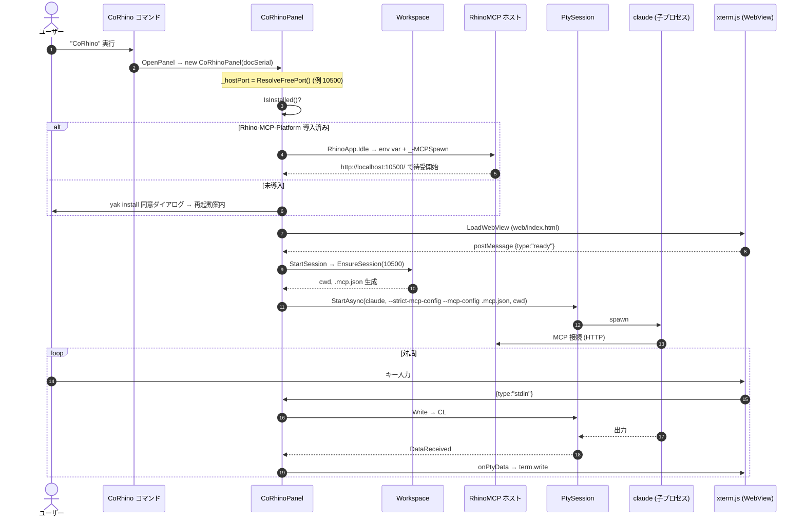
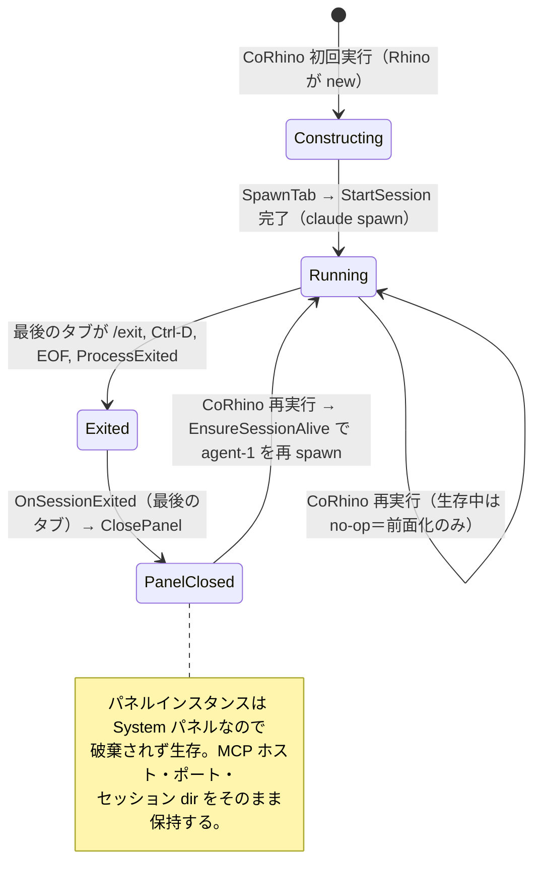

# CoRhino アーキテクチャ

新規コントリビューター（および将来の自分）が、コードを開く前に**全体像と「なぜこの形か」**を掴むためのドキュメント。
記述はすべて 2026-06-03 時点のソースを正本とし、要所に `ファイル:行` を添えた。挙動が疑わしいときは
このドキュメントではなくコードを信じること。設計の経緯・検証履歴は [`design-history.md`](design-history.md)、
利用手順は [`../README.md`](../README.md) を参照。

---

## 0. このドキュメントの読み方

- **1章**で「何を作っているか・責務境界」を掴む。ここだけ読めば概念は分かる。
- **2章**は各ファイルの責務を1つずつ（コンポーネント単位の MECE 分解）。
- **3章**は複数コンポーネントをまたぐデータフロー（プロセス境界・プロトコル・シーケンス図）。
- **4–5章**はライフサイクル／状態と、ポート分離モデル。バグの温床になりやすい所。
- **6–10章**はリファレンス（プラットフォーム差・設計判断トレース・設定一覧・内在制約・用語集）。
- 「なぜこの形か」の経緯・検証ログは [`design-history.md`](design-history.md)、今後の作業は [`roadmap.md`](roadmap.md)。

---

## 1. 全体像

### 1.1 一文での定義

> **CoRhino は、Rhino 8 のサイドパネルに Claude Code（`claude` CLI）をドックし、PTY 経由で起動した
> その `claude` を、公式 Rhino-MCP-Platform の HTTP ホストに direct-HTTP でつないで「いま開いているその
> Rhino」を操作させる C# プラグインである。**

非エンジニアが「パネルを開くだけ」で使えることが目標。`MCPConnect`／設定ファイルの貼り付け／手動の MCP
起動を一切踏ませない。

### 1.2 責務境界（最重要）

CoRhino は **インターフェースだけ**を作る。Rhino 操作の中身は持たない。

```
┌─────────────────────────────────────────────────────────────┐
│ CoRhino が持つ（このリポジトリ）                              │
│  • パネル UX（WebView + xterm.js のターミナル）               │
│  • 起動配線（claude を PTY で spawn し、MCP 設定を注入）       │
│  • ホスト MCP の自動起動（_-MCPSpawn + env var）              │
│  • オンボーディング（Rhino-MCP-Platform の yak 自動導入）     │
│  • セッションのライフサイクル管理（終了検知・再起動・分離）   │
└─────────────────────────────────────────────────────────────┘
┌─────────────────────────────────────────────────────────────┐
│ CoRhino が持たない（公式 Rhino-MCP-Platform に乗る）          │
│  • Rhino 操作の tools（run_python / list_objects / …）        │
│  • HTTP MCP サーバの実装本体                                  │
│  • agents / commands / skills                                 │
│  → vendoring（フォーク同梱）しない。McNeel が育てたものに乗る │
└─────────────────────────────────────────────────────────────┘
```

この線引きが設計判断 **D2**（→ 7章）。CoRhino にツールを実装しそうになったら、それは Rhino-MCP-Platform
側の仕事。

例外は同梱 cc-plugin（→ 2.3 / D8）: `save-rhino-skill` など、**Rhino 操作ノウハウではなく CoRhino 自身の
規約**（スキルの保存先 `~/.corhino/skills` と反映方法）を教えるオンボーディングスキルは CoRhino が持つ。
Rhino の操作方法を教えるスキル・agents を書きたくなったら、それは Platform 側（配布用プラグイン）の仕事。

### 1.3 主要登場人物（プロセス／コンポーネント地図）

CoRhino は**単一の Rhino プロセス内**で完結する。外部の node router や別 Rhino プロセスは spawn しない。

```
┌───────────────────────────── Rhino 8 プロセス ─────────────────────────────┐
│                                                                            │
│   ┌──────────────────────── CoRhino プラグイン (.rhp / C#) ─────────────┐  │
│   │                                                                     │  │
│   │  CoRhinoPlugin        起動時ロード・パネル登録                       │  │
│   │  OpenCoRhinoPanelCommand   "CoRhino" コマンド＝唯一の入口            │  │
│   │                                                                     │  │
│   │  CoRhinoPanel  ──────── オーケストレータ（全部ここから配線）         │  │
│   │   │   ├─ WebView ──(JSON msg, agentId 多重化)──▶ xterm.js UI(タブ式) │  │
│   │   │   │                ▲                                            │  │
│   │   │   │           (onPtyData(agentId,…))                            │  │
│   │   │   ├─ PtySession×N ─▶ 子プロセス: claude×N（タブごと=エージェント）│  │
│   │   │   ├─ Workspace ──▶ ~/.corhino/workspace/（全セッション共有 cwd）│  │
│   │   │   │                 + ~/.corhino/runtime/（spawn ごとの .mcp.json）│  │
│   │   │   └─ RhinoMcpInstaller ──▶ yak install（未導入時のみ）          │  │
│   │   │                                                                 │  │
│   │   └─ EnsureHostMcpStarted ──(env var + _-MCPSpawn)──┐               │  │
│   └─────────────────────────────────────────────────────┼─────────────┘  │
│                                                          ▼                 │
│   ┌──────────── Rhino-MCP-Platform プラグイン (.rhp) ─────────────────┐   │
│   │   HTTP MCP ホスト  http://localhost:<port>/                       │   │
│   │   tools: run_python / run_command / list_objects / …              │   │
│   └───────────────────────────────────────────────────────────────────┘   │
│                                                          ▲                 │
└──────────────────────────────────────────────────────────┼────────────────┘
                                                            │ direct-HTTP
                       claude（子プロセス）── MCP client ───┘
```

ポイント:
- `claude` は Rhino の**子プロセス**で、PTY 経由で標準入出力がパネルのタブにつながる。
- 1パネルは**複数の claude（タブ＝エージェント）を並列に**走らせられる（UI の「＋」で追加）。
  全エージェントが**同じ doc・同じポート**の RhinoMCP ホストに接続する（ホストはステートレスで
  ツール実行を UI スレッドで直列化するため、複数 claude が1つの doc を安全に操作できる）→ 5章。
- ポートは**パネル（＝Rhino インスタンス＝doc）ごとに採番**され、「どの Rhino を操作するか」を一意に固定する。
- 並列エージェントの**論理衝突**は、各エージェントに専用レイヤ接頭辞（`agent-1/` …）を割り当てる
  ソフト分離で避ける（CLAUDE.md に明記、ホスト無改修）→ 5章・設計判断 D7。

---

## 2. コンポーネント詳解

プロセス内の層ごとに分割（MECE）。各節は「責務 → 要点 → 参照」の順。

### 2.1 プラグイン本体 — `CoRhinoPlugin.cs`

**責務**: Rhino 起動時にロードされ、パネル型を Rhino に登録するだけ。

- `LoadTime => AtStartup`（[CoRhinoPlugin.cs:19](../src/CoRhinoPlugin.cs#L19)）。コマンド実行を待たず起動時にロードされる。
  これにより、パネルを開く前から（厳密には初回パネル構築時から）配線できる。
- `OnLoad` で `Panels.RegisterPanel(..., typeof(CoRhinoPanel), "CoRhino", ..., "CoRhino.icon.png", PanelType.System)`
  （[CoRhinoPlugin.cs:23](../src/CoRhinoPlugin.cs#L23)）。アイコンは埋め込みリソース（csproj の `LogicalName="CoRhino.icon.png"`）。
- アセンブリ GUID: `4C13D5E0-9E5A-4F18-9C2A-1E9E1A7B3C01`（[CoRhinoPlugin.cs:6](../src/CoRhinoPlugin.cs#L6)）。
- `PanelType.System` の含意は重要 → **Rhino がパネルインスタンスをキャッシュし、閉じても `Dispose` しない**。
  これが 4 章の再起動設計の前提になる。

### 2.2 コマンド — `OpenCoRhinoPanelCommand.cs`

**責務**: ユーザーが叩く唯一のコマンド `CoRhino`。パネルを開き、必要なら claude を再起動する。

`RunCommand`（[OpenCoRhinoPanelCommand.cs:12](../src/Commands/OpenCoRhinoPanelCommand.cs#L12)）は2手:

1. `Panels.OpenPanel(typeof(CoRhinoPanel).GUID)` — パネルを開く（初回は構築、2回目以降はキャッシュを前面に）。
2. `Panels.GetPanel<CoRhinoPanel>(doc)?.EnsureSessionAlive()` — 生存インスタンスに「セッション生きてる？死んでたら再起動して」と頼む。

**なぜコマンドが再起動の入口なのか**: System パネルはキャッシュされコンストラクタが再実行されないので、`/exit` で
claude が死んだ後に「×→再オープン」しても何も起きない。再起動トリガを**コマンド再実行**に固定することで、
`Dispose` されない前提に依存せず確実に再起動できる（→ 4.2）。セッションが生きていれば `EnsureSessionAlive` は
no-op（パネルが前面に来るだけ）。

### 2.3 パネル — `CoRhinoPanel.cs`（オーケストレータ）

**責務**: 本プラグインの中心。WebView の保持、ポート採番、MCP ホスト起動、**複数 claude（タブ＝エージェント）の
起動・多重化**、UI ⇄ PTY の双方向中継、終了検知と再起動、ドキュメント切替対応——配線のほぼ全てをここが握る。

`Eto.Forms.Panel` を継承。クラス GUID `4C13D5E0-…-3C02`（[CoRhinoPanel.cs:14](../src/Panel/CoRhinoPanel.cs#L14)）。

#### タブ＝エージェントのモデル

1パネル = 1 doc = 1 ホストポートだが、その上で **複数の claude を並列に**走らせる。各タブを内部クラス
`AgentTab`（`AgentId` / `LayerPrefix` / `PtySession` / 出力バッファ `Pending` / `SessionId` / `CustomName`）で表し、
`Dictionary<string, AgentTab> _tabs`（agentId キー）で保持する。agentId は `agent-1, agent-2, …`（`_nextAgentNum`
連番）で、**純粋な UI/PTY ルーティングキー**——共有ワークスペース（D11）ではディスク上のリソースに対応しないため、
パネル間の重複も無害。各タブは spawn 時に採番した claude セッション ID（`SessionId`、`--session-id`/`--resume` で
claude に固定させる）を持ち、タブ⇄トランスクリプトの対応を C# が常に把握する。**実行中セッションの集合は
プロセス全体の static `LiveSessionIds`**（doc ごとの複数パネルは macOS では1プロセス内に共存する。同じ
トランスクリプトに2つの claude が付くと履歴が混線するため、resume 判定はパネル横断でなければならない）。
登録/解除は `RegisterTab`/`UnregisterTab` に一元化（全パネルの変異が同一 UI スレッドなのでロック不要）。
レイヤ接頭辞は `ClaudeCli.LayerTokenFor(sessionId)`（`s-<先頭8桁>`）で**セッションから決定的に導出**し、spawn 時に
`--append-system-prompt` で注入する（→ 5章 / D11）。`_tabs` は UI スレッド
（メッセージハンドラと AsyncInvoke 済みの PTY コールバック）からのみ触るのでロック不要。

#### 構築の流れ（コンストラクタ [CoRhinoPanel.cs:60](../src/Panel/CoRhinoPanel.cs#L60)）

Rhino がドキュメントごとに `new CoRhinoPanel(uint documentSerialNumber)` を呼ぶ。**フィールド初期化子が本体より先**:

```
① _hostPort = Workspace.ResolveFreePort()           … フィールド初期化子（★本体より前にポート確定）
② _documentSerialNumber = documentSerialNumber      … 自分の doc を記憶（閉じるとき使う）
③ WebView 生成 + MessageReceived 購読               … DEBUG ビルドは Inspectable=true
④ EndOpenDocument / NewDocument 購読                … doc 切替でホスト再起動
⑤ IsInstalled() ? EnsureHostMcpStarted() : RunOnboarding()
⑥ Content = _webView; LoadWebView()
⑦ SpawnTab()                                        … 最初のエージェント agent-1 を起動
```

`①` のおかげで、`⑤` の MCP ホスト起動も各タブの `.mcp.json` 生成も**同じポートを共有**する。

#### 主要メソッド

| メソッド | 役割 | 参照 |
|---|---|---|
| `SpawnTab` | 次の agentId を採番 → 新規セッション ID 採番 → `AgentTab` 登録 → UI へ `onTabCreated` → 背景で CLI 起動 | [CoRhinoPanel.cs](../src/Panel/CoRhinoPanel.cs) |
| `ResumeSession` | Sessions Drawer からの再開。allowlist（`SessionsCatalog.TryGetKnown`）＋ jsonl 存在＋非実行中（`LiveSessionIds`）を検証し、`Resume=true` の新規タブとして spawn | [CoRhinoPanel.cs](../src/Panel/CoRhinoPanel.cs) |
| `RenameSession` | 名前を `session-names.json` に永続化（空で削除）→ live タブなら `onTabLabel` → 一覧再送 | [CoRhinoPanel.cs](../src/Panel/CoRhinoPanel.cs) |
| `DeleteSession` | トランスクリプト（jsonl + `<id>/` subagents dir）と名前を削除。allowlist＋非実行中のみ | [CoRhinoPanel.cs](../src/Panel/CoRhinoPanel.cs) |
| `LoadWebView` | `CORHINO_WEBUI_URL` があれば dev サーバ URL を、なければ plugin dir の `web/index.html` を `LoadHtml` | [:175](../src/Panel/CoRhinoPanel.cs#L175) |
| `StartSession(tab)` | CLI 解決 → そのエージェントの session dir 準備 → claude を PTY で spawn（後述） | [:207](../src/Panel/CoRhinoPanel.cs#L207) |
| `EnsureHostMcpStarted` | `RhinoApp.Idle` ワンショットで env var セット + `_-MCPSpawn` 発火（全タブ共有・1回） | [:266](../src/Panel/CoRhinoPanel.cs#L266) |
| `OnDocChangedRestartHost` | doc 切替/新規時、導入済みならホスト再起動 | [:303](../src/Panel/CoRhinoPanel.cs#L303) |
| `OnMessageReceived` | WebView → C# の JSON を捌く（ready/createTab/closeTab/stdin/resize/listSkills/openSkill/reloadSkills/listSessions/resumeSession/renameSession/deleteSession/debug、agentId で振り分け） | [CoRhinoPanel.cs](../src/Panel/CoRhinoPanel.cs) |
| `OnPtyData(tab,…)` | PTY 出力を UTF-8 化し該当タブへ（未 ready ならそのタブの `Pending` にキュー）。id 再利用に備え `ReferenceEquals` で stale を破棄 | [CoRhinoPanel.cs](../src/Panel/CoRhinoPanel.cs) |
| `OnSessionExited(tab,…)` | claude 終了 → `RemoveTab(tab)` を UI スレッドで呼ぶ | [CoRhinoPanel.cs](../src/Panel/CoRhinoPanel.cs) |
| `RemoveTab(tab)` | **タブ撤去の単一経路**（exit / ×ボタン / 起動失敗 共通）。id→別インスタンスなら no-op。Session Dispose + `onTabClosed` + 空なら `ClosePanel` | [CoRhinoPanel.cs](../src/Panel/CoRhinoPanel.cs) |
| `CloseTab` | ユーザーの「×」操作。`Dispose` は `Exited` を抑止するので、`RemoveTab` で直接撤去する | [CoRhinoPanel.cs](../src/Panel/CoRhinoPanel.cs) |
| `EnsureSessionAlive` | 全タブ死亡（`IsRunning`/`Starting` とも false）なら全 Dispose → `onTabsReset` → agent-1 を再 spawn | [CoRhinoPanel.cs](../src/Panel/CoRhinoPanel.cs) |
| `Dispose` | doc イベント解除 + 全タブ `Session.Dispose()` | [:381](../src/Panel/CoRhinoPanel.cs#L381) |

#### claude の起動引数（`ClaudeCli.BuildArgs` → `StartSession` が PTY spawn）

引数の組み立ては CLI アダプタ（`src/Cli/ClaudeCli.cs` → 2.7b）の仕事。`StartSession` は CLI 非依存の
PTY 配線（解決→SpawnContext→BuildArgs→spawn→フォールバック）だけを持つ。

```
claude --strict-mcp-config --mcp-config <~/.corhino/runtime/mcp-<port>-<agentId>.json>
       --plugin-dir <~/.corhino/skills> --plugin-dir <plugin dir>/cc-plugin
       --session-id <fresh GUID>   （resume タブは代わりに --resume <sessionId>）
       --append-system-prompt "このセッションの担当 Rhino レイヤは `s-XXXXXXXX` です。…"
```

- `--strict-mcp-config` … ユーザーのグローバル/プロジェクト MCP 設定を一切読まない（`~/.claude` を汚さない＝D3）。
- `--mcp-config <path>` … この**エージェント専用**の `rhino`（http）サーバだけをロード。同一ポートを指すが
  `X-CoRhino-Agent` ヘッダで接続を区別する（→ D7）。
- `--plugin-dir <~/.corhino/skills>` … ユーザー自作スキルの local plugin を全セッションに載せる
  （`Workspace.EnsureUserSkillsPlugin` が骨格を保証 → 2.4 / D8）。
- `--plugin-dir <plugin dir>/cc-plugin` … CoRhino 同梱のオンボーディングスキル（`save-rhino-skill`：
  会話から `~/.corhino/skills` へ規約どおりスキルを書き出すメタスキル）。リポジトリの `cc-plugin/` を
  ビルドが assembly 隣へコピーする（web/ と同じ配送）。無ければ黙ってスキップ。
- `--session-id <GUID>` … 新規タブは spawn 時に C# が採番した ID を claude に固定させる。これでタブ⇄
  トランスクリプト（`~/.claude/projects/<cwd-slug>/<id>.jsonl`）の対応をパース無しで把握できる（→ D10）。
  resume タブは `--resume <id>`（`--fork-session` は付けない＝同じ jsonl が伸び続ける）。
- `--append-system-prompt` … セッション紐付けの担当レイヤ（`ClaudeCli.LayerTokenFor(sessionId)` = `s-<先頭8桁>`）を注入する。
  共有 CLAUDE.md はルールだけを持ち、セッション固有の値はここで届ける（→ D11）。決定的導出なので
  resume でも同じレイヤが復元される。
- cwd は `Workspace.EnsureWorkspace()` が返す**全セッション共有**の `~/.corhino/workspace/`。
  **アクティブ `.3dm` には追従しない**（D5）。ポートにもタブにも依存しない（D11）。
- claude が PATH に無ければ `bash -l`（Unix）/ `cmd.exe`（Windows）へフォールバック。
- Windows で `claudePath` が `.exe` でない（`.cmd`/`.bat` 等）場合は `cmd.exe /c <path> <args>` で起動。

#### 出力バッファリング

WebView の準備（`ready`）やタブ生成より前に PTY 出力が届くことがあるので、`_webReady` が立つまで
**そのタブの `Pending` キュー**に溜め、`ready` 受信時に各タブを `onTabCreated` で announce してから `FlushPending` で流す。

#### Skills Drawer の配線（`SkillsCatalog.cs` + watcher）

パネル右サイドのスキル一覧ドロワー（→ 2.9）の C# 側。スキャンとパースは **`SkillsCatalog.cs`**
（UI 非依存の static クラス）に分離されている:

- `SkillsCatalog.Scan(loadedAtUtc)` … user（`~/.corhino/skills/skills/*/SKILL.md`）と bundled
  （`<assembly dir>/cc-plugin/skills/*/SKILL.md`）を列挙し、frontmatter の `name:`/`description:`
  **単一行値のみ**をパース（YAML ライブラリなし。壊れたファイルはディレクトリ名にフォールバックし一覧から消さない）。
- **needsReload の近似**: claude 内部のロード状態は外から読めないため、各 `AgentTab` の
  `SkillsLoadedAtUtc`（spawn 時に初期化、reloadSkills で now に更新）と SKILL.md の mtime を比較する。
  誤検知は「⟳ を押せば必ず正しい状態に収束する」方向にしか倒れない。
- `IsKnownSkillPath` … `openSkill` のパス検証。**直近 Scan が返した path 集合に含まれるものだけ**を
  `Process.Start`（UseShellExecute）で開く。WebView からの任意パス起動を防ぐ。
- **FileSystemWatcher**: `~/.corhino/skills/skills/` を再帰監視。イベントは 300ms の one-shot
  `System.Threading.Timer` を再アームするだけ（エディタの保存は複数イベントを発火する）で、タイマーの
  コールバックが `AsyncInvoke` で UI スレッドに戻り**全タブ分**の `onSkillsList` を push する。
  C# はアクティブタブを知らない——UI 側が自分のアクティブタブと一致する payload だけ描画し、
  ドロワー閉時は無視する（開閉状態を C# と同期しない）。パネル `Dispose` で watcher/timer とも破棄。

#### Sessions Drawer の配線（`SessionsCatalog.cs` + `SessionNames.cs`）

過去セッション一覧ドロワー（→ 2.9）の C# 側。SkillsCatalog と同じ規律で分離されている:

- `SessionsCatalog.Scan()` … 共有ワークスペースの cwd→slug 変換（`ProjectSlug`、ASCII 英数字以外→`-`。
  Windows は未検証）で得た**単一の** `~/.claude/projects/<slug>/` の**トップレベル** `*.jsonl` だけを列挙
  （サブエージェントのトランスクリプトは `<id>/subagents/` サブ dir に隔離されている）。head 64KB から
  開始時刻＋最初のユーザープロンプト、tail 256KB を後方走査して**最後の** `ai-title`（fallback:
  `last-prompt`）を取る。チャンク境界は最初の改行まで捨てて UTF-8 破断を回避。**空セッションは除外**
  （claude は spawn しただけで jsonl を作るため、非メタ user 行・ai-title・last-prompt のいずれも無いものは
  一覧に出さない）。トランスクリプトは MB 級——**必ず BG スレッド**（`RequestSessionsScan` の `Task.Run`、
  `Interlocked` single-flight + pending 再スキャン）で走らせ、結果を `AsyncInvoke` で UI スレッドへ渡す。
- **カタログはタブを知らない**: `Scan()` は生の事実だけ返し、実行中（`LiveSessionIds`）の装飾は UI スレッドの
  `SendSessionsList` が付与する（BG スレッドからタブ状態は触れない）。
- `TryGetKnown` … `resumeSession` の allowlist。**直近 Scan が返した sessionId だけ**が resume 可能
  （openSkill の `IsKnownSkillPath` と同型。WebView からの任意 ID 起動を防ぐ）。spawn 前に jsonl の存在も
  再検証する（消えた ID で claude が即死すると、唯一のタブだった場合パネルごと閉じてしまうため）。
- `SessionNames` … `~/.corhino/session-names.json` の `{sessionId: name}` を lock + write-through で所有。
  リネームは UI スレッド、読み出しはスキャン（BG）からも来る。V1 では剪定しない（live タブの ID はまだ
  jsonl が無いことがあり、スキャン基準の剪定は新しい名前を食う）。

**責務**: **エージェント（タブ）ごとの**作業ディレクトリと設定ファイルの生成・所有。`static` ユーティリティ。

- ベース: `~/.corhino`。cwd は**全セッション共有**の `~/.corhino/workspace/`（`EnsureWorkspace`、
  [Workspace.cs](../src/Panel/Workspace.cs)）。claude の履歴（`~/.claude/projects/<cwd-slug>`）は cwd キーで
  `--resume` は同じ cwd からしか効かないため、cwd を1つに固定すれば**どのセッションもいつでも resume 可能**
  （D11。ポートドリフトにも当然影響されない）。spawn ごとの `.mcp.json` は `EnsureAgentMcpConfig` が
  `~/.corhino/runtime/mcp-<port>-<agentId>.json` に書く——`--mcp-config` は明示パスを取るので cwd に置く
  必要がなく、port がパネル一意なのでパネル間で衝突しない（claude は起動時に一度読むだけ）。
- `ResolveFreePort(count=100)`: `BasePort=10500` から順に `TcpListener` で bind 試行し、最初に空いたポートを返す。
  100 個全滅なら 10500 を返す（その場合は後段の bind エラーで顕在化）。**ポートはパネル単位**（1パネル内の
  全エージェントは同じポートを共有する）。
- `EnsureWorkspace()`: 共有 dir を作成し、`CLAUDE.md` を**存在しなければ**テンプレから seed（以後ユーザー
  所有、上書きしない）。テンプレは並列エージェントのルールを持つが、担当レイヤの**値**は持たない——
  それはセッション固有なので `--append-system-prompt` が届ける（→ 2.3 / D11）。戻り値 = claude の cwd。
  テンプレ（CLAUDE.md・skills README/manifest も同様）は **seed 時点の Rhino 言語**（`L10n`）で書かれ、
  以後ユーザー所有なので言語を変えても追従しない（作り直したければ削除して再 seed）。レイヤ指示の
  `--append-system-prompt` とオンボーディングダイアログは spawn/表示のたびに現在の言語で出る。
- `.mcp.json` の中身: サーバは1つだけ。全エージェントが同じポートを指すが、**`X-CoRhino-Agent` ヘッダ**で
  接続を区別する（将来のホスト側帰属/リース用フック。現状は未使用 → D7）。
  ```json
  { "mcpServers": { "rhino": { "type": "http", "url": "http://localhost:<port>/",
                               "headers": { "X-CoRhino-Agent": "<agentId>" } } } }
  ```
- `CLAUDE.md` テンプレ: セッションの性質、**並列エージェントのルール**（担当レイヤ `<agentId>` 配下のみ書き込み・
  他レイヤは読み取りのみ・他エージェントの変更は都度問い合わせ）、RhinoMCP 主要ツール、進め方を日本語で説明。
  これが各 claude セッションの最初のシステム文脈になる。
- `EnsureUserSkillsPlugin()`:
  - `~/.corhino/skills/` にユーザースキル plugin の骨格（`.claude-plugin/plugin.json` + `skills/` +
    README.md）を**無ければ** seed。以後ユーザー所有、上書きしない（CLAUDE.md と同じ方針）。
  - 戻り値 = plugin root。`StartSession` が `--plugin-dir` で claude に渡し、全パネル・全タブの
    セッションに自作スキルが載る。スキル本文は CoRhino が持たない（**配線のみ**＝D2 の境界を維持 → D8）。

### 2.5 オンボーディング — `RhinoMcpInstaller.cs`

**責務**: Rhino-MCP-Platform（yak パッケージ）が無いとき、ユーザーに `yak install` を打たせずに自動導入する（Phase 2a）。

- 導入検出 `IsInstalled()`（[:31](../src/Panel/RhinoMcpInstaller.cs#L31)）: `PlugIn.PlugInExists(PluginId, …)`。
  - `PluginId = 2668d7ed-f507-4a68-8295-8172147a0e39`（RhinoMCP の `AssemblyInfo.cs` 由来）。
  - **なぜ plugin id で見るか**: yak パッケージ dir のスキャンだと、ローカル Debug コピー（yak パッケージではない）を
    「未導入」と誤判定する。plugin id なら Rhino が登録した時点で true になり、Debug コピーも拾える。
- `RunOnboarding()`（[:39](../src/Panel/RhinoMcpInstaller.cs#L39)）: モーダルがパネル構築を止めないよう `RhinoApp.Idle` ワンショットに遅延。
- `StartOnboarding()`（[:54](../src/Panel/RhinoMcpInstaller.cs#L54)）:
  1. `ResolveYak()` で yak CLI を解決。見つからなければ手動導入を促すエラーダイアログで終了。
  2. 同意ダイアログ（Eto `MessageBox` YesNo）を**1回だけ**。No なら何もしない。
  3. Yes → `Task.Run` で**バックグラウンド** `yak install Rhino-MCP-Platform`。進捗はコマンドライン、完了/失敗は
     ネイティブダイアログ。完了時は「Rhino 再起動」を案内（yak 導入プラグインは起動時しかロードされないため）。
- `RunYakInstall`（[:105](../src/Panel/RhinoMcpInstaller.cs#L105)）: stdout/stderr を取り、120 秒タイムアウト（超過は kill）、`ExitCode==0` で成功判定。
- `ResolveYak`（[:147](../src/Panel/RhinoMcpInstaller.cs#L147)）: **実行中の Rhino に同梱された** yak を使う。
  - Windows: `RhinoApp` アセンブリと同居の `yak.exe`。
  - macOS: 実行プロセスの `MainModule`（`…/Contents/MacOS/Rhinoceros`）から `…/Contents/Resources/bin/yak`。

### 2.6 PTY セッション — `PtySession.cs`

**責務**: `Porta.Pty` で疑似端末を張り、子プロセス（claude）の spawn・入出力・終了検知・破棄を担う。
**使い捨て**（一度終了したら再 `StartAsync` せず、新インスタンスを作る）。

- `StartAsync`（[:24](../src/Pty/PtySession.cs#L24)）: 既に起動済みなら例外（再利用禁止＝使い捨ての契約）。
  - **環境は allow-list 方式**（[:31](../src/Pty/PtySession.cs#L31)）: `HOME USER LOGNAME PATH SHELL LANG LC_ALL LC_CTYPE TMPDIR` だけを
    親から引き継ぎ、呼び出し側 `env`（PATH 上書き等）をマージ、`TERM` 既定 `xterm-256color`。Rhino の汚れた環境を
    claude に丸ごと渡さない。
  - `PtyProvider.SpawnAsync` → `IPtyConnection`。`ProcessExited` を購読し `HandleExit`（[:57](../src/Pty/PtySession.cs#L57)）。
  - `ReadLoop`（[:69](../src/Pty/PtySession.cs#L69)）: 4096 バイトずつ読み `DataReceived` を発火。**EOF も終了シグナルとして扱う**
    （ホストによっては `ProcessExited` が来ないため）。
- `HandleExit`（[:101](../src/Pty/PtySession.cs#L101)）: `Interlocked` で**1回だけ**実行。接続を dispose、`_connection=null`（→ `IsRunning=false`）、
  `Exited` 発火。`ProcessExited` と EOF の二経路から呼ばれても冪等。
- `IsRunning => _connection != null`（[:22](../src/Pty/PtySession.cs#L22)）。終了検知でこれが false になることが、再起動判定の根拠。
- `Write`/`Resize`（[:109](../src/Pty/PtySession.cs#L109)）、`Dispose`（[:121](../src/Pty/PtySession.cs#L121)）: Dispose は先に「exited 済み」マークを立て、二重発火を防いでから
  CTS キャンセル・Kill・dispose。

### 2.7 CLI 解決 — `CliResolver.cs`

**責務**: エージェント CLI バイナリ（`Resolve(binaryName)`、`claude` / `codex` …）の絶対パスと、
ログインシェルの `PATH` を解決する。**毎回解決**（キャッシュなし）— spawn は常に現在の PATH 状態を見るので、
Rhino 起動中にインストールされた CLI も次の spawn から拾える。

- Unix: `bash -lc "command -v <bin> || which <bin>"` と `bash -lc 'echo -n "$PATH"'`。
  **ログインシェル経由**なのは、Rhino の PATH には nvm/homebrew 等のパスが入っていないことが多いから。
  binaryName はシェルコマンドに埋め込まれるため、**アダプタ定数（`IAgentCli.BinaryName`）以外を渡さない**こと。
- Windows: `where.exe <bin>` の結果から **`.exe` を最優先**（`.cmd` → `.bat` → 先頭）。
  - `.cmd` shim を引いたら、その中身から実体 `.exe` を正規表現で抽出して差し替える（`ResolveCmdShimTarget`）。
  - **なぜ**: `cmd.exe` を噛ませると ConPTY の ANSI シーケンス透過が乱れ、Ink ベースの claude TUI が
    チラつく／バナーが重複する。直接 `.exe` を起動すればこれを避けられる。

### 2.7b CLI アダプタ層 — `src/Cli/`

**責務**: CLI ごとの差分（起動引数・MCP 隔離・セッション同定・レイヤ指示注入・機能可否）を
`IAgentCli` 実装に閉じ込める。PTY 配線・タブ管理・WebView 中継は CLI 非依存なので `CoRhinoPanel` に残る。
設計は [`plans/codex-cli-support-design.md`](plans/codex-cli-support-design.md)（D12）。

- `IAgentCli.cs` … アダプタ contract + `SpawnContext` record（spawn 時に UI スレッドで組んでアダプタへ渡す。
  アダプタはパネル状態に触らない）。`BuildArgs` / `LayerTokenFor` / `DiscoverSessionIdAsync` /
  `SupportsSkillsDrawer` / `BinaryName` / `DisplayName`。
- `ClaudeCli.cs` … 旧 `StartSession` の claude 固有部を移設（`--strict-mcp-config` + `--mcp-config` /
  `--plugin-dir` ×2 / `--session-id`|`--resume` / `--append-system-prompt`。順序も旧実装と同一）。
  レイヤは sessionId から決定的導出（旧 `LayerFor` と同じ `s-<先頭8桁>`）。
- `AgentCliRegistry.cs` … Kind → シングルトン instance（現状 Claude のみ登録）。アダプタはステートレスで、
  spawn ごとの状態は `SpawnContext` で運ぶ。
- 各 `AgentTab` は自分の `Cli`（アダプタ参照）を持ち、`StartSession` は
  「解決（`CliResolver.Resolve(cli.BinaryName)`）→ `SpawnContext` 構築 → `cli.BuildArgs(ctx)` → PTY spawn」
  という CLI 非依存の手順だけを持つ。

### 2.8 ログ — `Log.cs`

**責務**: 単純な追記ログ。2つの入口を持つ（[Log.cs:13](../src/Log.cs#L13)）。

- `Log.Write` — 診断トレース。`%TMPDIR%/CoRhino.log` にロック付きで追記するだけで、コマンドラインには出さない。
  デバッグはこのファイルを `tail` するのが基本
- `Log.User` — ユーザー向け。`RhinoApp.WriteLine` でコマンドラインに出し、ファイルにも追記する。
  ダイアログもパネル UI も持たないユーザー影響のある失敗（claude CLI 不在フォールバック、PTY 起動失敗、
  MCPSpawn 失敗、`web/index.html` 欠落）とインストール進捗のみに限定する

### 2.9 UI 層 — `ui/`（xterm.js）

**責務**: WebView 内に**タブ式**の xterm.js ターミナル群と**2つのドロワー**（スキル一覧・セッション一覧）を
描画し、キー入力を C# へ、PTY 出力を画面へ流す。エントリは `ui/src/main.ts`、ドロワーは
`ui/src/skills-drawer.ts` / `ui/src/sessions-drawer.ts` に分離。

- **シェル構造**: `#terminal` を縦 flex にし、上に**タブバー** `#tabbar`（タブボタン群 + 「＋」 + 右端の
  🕘 `#sessionsbtn` と ⚡ `#skillsbtn`）、下に横 flex の `#main`（ターミナル領域 `#terminals` + 右の
  `#skillsdrawer` / `#sessionsdrawer`、各 260px 固定・閉時 `display:none`）を JS で構築。
  **ドロワーは排他**——片方を開くともう片方は閉じる（`close()` API）。各タブ = 絶対配置の `.termpane`、
  アクティブのみ表示。
- **タブ管理**: `Map<agentId, Tab>`（`Tab = { agentId, sessionId, term, fit, pane, tabEl, labelEl, … }`）と `activeTab`。
  - `addTab(payload)` … pane + xterm を生成し、開いてアクティブ化。`onData`/`onResize` を **agentId 付き**で post。
  - `activateTab` … 他を隠し対象を表示 → `fit()` → focus。
  - `removeTab` … dispose + DOM 除去、隣のタブをアクティブ化。
  - 「＋」→ `createTab` を post（採番は C# 側）。各タブの「×」→ `closeTab` を post。
  - **タブラベル**: 初期値は `onTabCreated` の `label`（手動名 > 自動タイトル > agentId を C# が計算）。
    ラベルの**ダブルクリック**でインライン `<input>` に切替（Enter=確定 / Esc=取消 / blur=確定、空で自動
    タイトルに戻す）→ `renameSession` を post。反映は C# の `onTabLabel` push を待つ（楽観描画しない）。
- **言語**（`i18n.ts` + `L10n.cs`）: UI 文言は **Rhino の言語設定に追従**する（`AppearanceSettings.LanguageIdentifier`
  が 1041=日本語なら日本語、それ以外は英語の2択）。C# が `LoadWebView` で単一 HTML の `<head>` に
  `window.CORHINO_LANG` を注入し、シェルは boot 時に同期的に正しい言語で DOM を組む（dev サーバ経路は
  注入点が無いのでブラウザロケールにフォールバック）。Rhino の言語変更は再起動必須なのでプロセス中は固定。
- **ブリッジ** `post()`: 環境ごとに送信口が違う（macOS=`window.eto`、Windows=`window.chrome.webview`、レガシー=`window.external.notify`）。
- **送信メッセージ（Outbound）**: `ready` / `createTab` / `closeTab{agentId}` / `stdin{agentId,data}` /
  `resize{agentId,cols,rows}` / `listSkills{agentId}` / `openSkill{path}` / `reloadSkills{agentId}` /
  `listSessions` / `resumeSession{sessionId}` / `renameSession{sessionId,name}` /
  `deleteSession{sessionId}` / `debug`。
- **受信窓口** `window.CoRhinoPanel`: C# 側が `ExecuteScriptAsync` で呼ぶ。
  - `onTabCreated({agentId, sessionId, label, customName})` → タブ＋xterm を生成しアクティブ化
  - `onPtyData(agentId, text)` → 該当タブの `term.write(text)`
  - `onSessionRestart(agentId)` → 該当タブの `term.reset()`
  - `onTabClosed(agentId)` → そのタブを除去
  - `onTabsReset()` → 全タブ除去（reopen 再 spawn 前）
  - `onSkillsList(payload)` → スキルドロワーへ（閉時・非アクティブタブの payload は無視）
  - `onSessionsList(payload)` → セッションドロワーへ（閉時は無視。タブ非依存）
  - `onTabLabel({agentId, label})` → 該当タブのラベル更新（リネーム確定・自動タイトル出現時）
- **Skills Drawer**（`skills-drawer.ts`）: ⚡ で開閉（開閉時にアクティブタブを `safeFit()`）。行 =
  状態ドット（`●` ロード済み / `⚠` 要 reload）+ name + 出所バッジ（自作/同梱）。クリックで description
  展開 + 「エディタで開く」（`openSkill`）。ヘッダ ⟳ = `reloadSkills`（C# が PTY へ
  `/plugin reload-plugins` を注入し、タブの `SkillsLoadedAtUtc` を進めて一覧を再送）。スキル名・説明は
  ユーザー作のファイル内容なので**必ず `textContent` で挿入**（innerHTML 禁止）。タブ切替時は新アクティブ
  タブ視点で `listSkills` を再要求する。
- **Sessions Drawer**（`sessions-drawer.ts`）: 🕘 で開閉（開時に `listSessions` を要求）。行 =
  表示名（手動名 ?? 自動タイトル）+ 相対時刻。**実行中**（どこかのタブで開いているセッション）のみ
  グレー・クリック不可、それ以外はクリックで `resumeSession`。✎ でインラインリネーム（タブと同じ
  Enter/Esc/blur 規約、編集中は push 再描画をスキップ）。🗑 で削除——ネイティブ `confirm()` は WebView で
  当てにならないため**2段階確認**（1クリック目で「削除?」にアーム、3秒で自動解除、2クリック目で確定）。
  実行中セッションには 🗑 を出さない。タイトルはモデル/ユーザー由来テキストなので
  **必ず `textContent`**。skills と違い一覧はタブ非依存（`handleSkillsList` のようなアクティブタブ
  フィルタは無い）。
- xterm 設定: `convertEol: true`。Windows ConPTY の bare `\n` 階段化を `\r\n` 合成で吸収。
- **macOS のキー欠落対策**: capture-phase の `keydown` で印字可能キーを先取りして**アクティブタブの** `term.input()` に流し、
  `input`/`beforeinput` を握り潰す（"rhino"→"rhn", xterm #5374）。IME 合成中は素通し。合成状態は各タブ生成時に
  textarea へ付けた compositionstart/end で共有フラグ管理（フォーカスは常にアクティブタブのみ）。
- **Windows の IME 対策**: 合成中に helper textarea が伸びる横スクロールを、textarea を **1×1 px** にクランプして防ぐ
  （Windows 限定）。0×0 は xterm が「IME が壊れる」と警告する条件（`CompositionHelper` は `Math.max(bounds, 1)` で 1px
  下限を保証）で、日本語 IME が確定済み先頭語を毎回再送する重複バグが出た（→ [design-history.md](design-history.md) B4）。
- **リサイズのデバウンス**: `#terminals` を観測する単一 `ResizeObserver` → 80ms デバウンス → **アクティブタブ**を `fit()`。
  paint→scrollbar→resize→repaint のループを断つ。

> 補足: `ui/src/main.js` / `vite.config.js` / `tsconfig.tsbuildinfo` は `.ts` のコンパイル出力で **gitignore 済み**。
> 正本は常に `.ts`。

### 2.10 ビルドパイプライン — `CoRhino.csproj` + vite

**責務**: `dotnet build` 一発で UI ビルド・ネイティブ処理・plugin dir へのコピーまで完結させる。

- ターゲット: `net8.0` / 出力拡張子 `.rhp` / `EnableDynamicLoading`（[csproj:1](../src/CoRhino.csproj#L1)）。
- 参照: `RhinoCommon` / `Eto` / `Rhino.UI`（`Private=false`＝Rhino が供給するので同梱しない）、Unix のみ `Microsoft.macOS`。
  NuGet は `Porta.Pty 1.0.7` のみ。
- **ビルドの連鎖**:
  1. `BuildUi`（[:60](../src/CoRhino.csproj#L60)）: `ui/` で `npm install`（`node_modules` 無いときのみ）→ `npm run build`（= `tsc -b && vite build`）。
  2. `CopyWebUi`（[:68](../src/CoRhino.csproj#L68)）: `ui/dist/**` を `$(TargetDir)/web/` へコピー。`DependsOnTargets="BuildUi"` で dist の存在を保証。
  3. `FlattenNativeLibs`（AfterTargets=Build, [:76](../src/CoRhino.csproj#L76)）: **macOS は `lipo -create` で arm64+x64 を1つのユニバーサル
     `libporta_pty.dylib` に融合**（フラット化で名前衝突→片方が勝つと dlopen 失敗するのを回避）。Windows は win-x64 native をコピー。
  4. `PostBuild`（AfterTargets=PostBuildEvent, [:91](../src/CoRhino.csproj#L91)）: `$(TargetDir)/**` を plugin dir へコピー（ロック中 DLL は skip）。
- **vite 設定**（[vite.config.ts](../ui/vite.config.ts)）: `viteSingleFile` + 自作 `classicAtBodyEnd` プラグインで、`type="module"` を剥がし
  巨大インライン `<script>` を `</body>` 直前へ移動（`#terminal` が DOM に存在してから走るように）。出力は iife。
  → **成果物は単一 HTML**。C# 側は `web/index.html` を `ReadAllText` して `LoadHtml` するだけで済む。
- **配置先（PluginDestDir）**:
  - macOS: `~/Library/Application Support/McNeel/Rhinoceros/8.0/MacPlugIns/CoRhino`
  - Windows: `%APPDATA%\McNeel\Rhinoceros\myplugins\CoRhino`
  - ⚠ コピー先を直接編集しないこと。必ず再ビルドで反映する。

---

## 3. 横断する仕組み（データフロー）

### 3.1 4つのプロセス／境界

CoRhino は内部に4つの通信境界を持つ。バグはたいていこの境界で起きる。

```
[1] WebView ⇄ C#      JSON 文字列（postMessage / ExecuteScriptAsync）
[2] C# ⇄ PTY          バイト列（stdin 書き込み / ReaderStream 読み出し）
[3] C# → RhinoMCP host RhinoApp.RunScript("_-MCPSpawn") + env var（同プロセス内コマンド）
[4] claude ⇄ host      HTTP（MCP, http://localhost:<port>/）— C# は関与しない
```

### 3.2 メッセージプロトコル（境界 [1]: WebView ⇄ C#）

**UI → C#（Outbound, `OnMessageReceived` が受信）** — `ready`/`debug` 以外は **`agentId` でタブを特定**する。

| `type` | ペイロード | C# の処理 |
|---|---|---|
| `ready` | — | `_webReady=true` → 各タブを `onTabCreated` で announce → `FlushPending` |
| `createTab` | — | `SpawnTab()`（次の agentId を採番し起動） |
| `closeTab` | `agentId` | `CloseTab(agentId)`（その PtySession を Dispose） |
| `stdin` | `agentId, data` | UTF-8 で該当タブの `Session.Write()`（PTY へ） |
| `resize` | `agentId, cols, rows` | 該当タブの `Session.Resize(cols, rows)` |
| `listSkills` | `agentId` | `SkillsCatalog.Scan`（そのタブの `SkillsLoadedAtUtc` 視点）→ `onSkillsList` |
| `openSkill` | `path` | `IsKnownSkillPath` 検証 → `Process.Start`（UseShellExecute）で SKILL.md を開く |
| `reloadSkills` | `agentId` | 該当タブの PTY へ `/plugin reload-plugins` 注入 → `SkillsLoadedAtUtc=now` → `onSkillsList` 再送 |
| `listSessions` | — | `RequestSessionsScan()`（BG スキャン → `onSessionsList`） |
| `resumeSession` | `sessionId` | allowlist＋jsonl 存在＋非実行中を検証 → 新規タブに `--resume` で spawn |
| `renameSession` | `sessionId, name` | `SessionNames.Set`（空で削除）→ live タブへ `onTabLabel` → 一覧再送 |
| `deleteSession` | `sessionId` | allowlist＋非実行中を検証 → jsonl + subagents dir + 名前を削除 → 一覧再送 |
| `debug` | `message` | `Log.Write("[Claude/UI] …")` |

**C# → UI（`ExecuteScriptAsync` で `window.CoRhinoPanel` を呼ぶ）**

| 呼び出し | UI の処理 |
|---|---|
| `onTabCreated({agentId, sessionId, label, customName})` | タブ＋xterm を生成しアクティブ化。label は初期タブ名（手動名 > 自動タイトル > agentId） |
| `onPtyData(agentId, text)` | 該当タブの `term.write(text)` |
| `onSessionRestart(agentId)` | 該当タブの `term.reset()`（再起動時に画面クリア） |
| `onTabClosed(agentId)` | そのタブを除去 |
| `onTabsReset()` | 全タブ除去（reopen 再 spawn 前） |
| `onSkillsList(payload)` | `{agentId, skills[]}`。ドロワーが開いていて payload がアクティブタブのものなら描画（それ以外は無視）。listSkills/reloadSkills への応答のほか、watcher 検知時に**全タブ分** push される |
| `onSessionsList({sessions[]})` | セッションドロワーが開いていれば描画（タブ非依存）。listSessions への応答のほか、タブ生成/消滅・resume・rename 後にも push される |
| `onTabLabel({agentId, label})` | 該当タブのラベルを更新（リネーム確定、スキャンで自動タイトルが判明したとき） |

### 3.3 起動シーケンス（初回 `CoRhino` 実行）



### 3.4 入出力ループ（定常状態）

- **入力**: キー → xterm `onData` → `post({type:"stdin"})` → `OnMessageReceived` → `_session.Write(UTF8)` → claude stdin。
- **出力**: claude stdout → PTY `ReaderStream` → `ReadLoop` → `DataReceived` → `OnPtyData` → `ExecuteScriptAsync("onPtyData")` → `term.write`。
- **リサイズ**: xterm `onResize` → `post({type:"resize"})` → `_session.Resize(cols,rows)` → PTY → claude が再描画。

> 入力・出力の各ステップを `ファイル:行` 付きで追ったコード単位の深掘りは [`details/io-flow-xterm-pty.md`](details/io-flow-xterm-pty.md) を参照
> （UTF-8 のチャンク境界問題など、ここでは触れない細部まで扱う）。

### 3.5 MCP 接続経路（境界 [4]）

claude は CoRhino が生成した `.mcp.json` だけを見て（`--strict-mcp-config`）、`rhino` サーバ
（`http://localhost:<port>/`）に HTTP で接続する。**この接続自体に C# は関与しない**——CoRhino の役目は
「正しいポートを指す設定を置く」「そのポートでホストを起動する」までで、あとは claude と RhinoMCP ホストの
HTTP 対話。ツール名前空間は `mcp__rhino__*`（[`design-history.md`](design-history.md) の実機検証 S1 で確認済み）。

---

## 4. ライフサイクルと状態

### 4.1 パネル／セッションの状態遷移



### 4.2 終了と再起動（設計の核心）

**問題**: かつて `/exit` でパネルが無言で固まり、開き直しても再起動しなかった。原因は2つの相互作用——
(a) `PtySession` が終了後も `_connection` を保持し `IsRunning` が true のままだった、
(b) System パネルはキャッシュされ `Dispose` されないのでコンストラクタ（＝1回限りの `StartSession`）が再実行されない。

**現在の解（コードで確認できる事実）**:

1. **終了検知の一元化** — `PtySession.HandleExit` を `ProcessExited` と ReadLoop の EOF 両方から呼び、
   `Interlocked` で1回だけ実行。接続を dispose し `IsRunning=false`、`Exited` 発火（[PtySession.cs:101](../src/Pty/PtySession.cs#L101)）。
2. **タブ単位の終了 → 最後のタブでパネル自動クローズ** — exit / ×ボタン / 起動失敗のいずれも
   **`RemoveTab(tab)` の単一経路**に集約する。`RemoveTab` はそのタブを `_tabs` から外して UI に `onTabClosed` を送り、
   **`_tabs` が空になったときだけ** `RhinoDoc.FromRuntimeSerialNumber(_documentSerialNumber)` で**自分の doc** を解決し
   `Panels.ClosePanel(GUID, doc)`。`ActiveDoc` に頼ると複数 doc で別パネルを誤って閉じる。
   - **×ボタンの注意**: `PtySession.Dispose` は `Exited` を抑止するので、×経由では `OnSessionExited` が来ない。
     だから `CloseTab` は `RemoveTab` を直接呼ぶ（Dispose 任せにしない）。
   - **id 再利用の安全化**: コールバックは agentId 文字列でなく **`AgentTab` インスタンス**を束縛し、`RemoveTab`/
     `OnPtyData` は `_tabs[agentId]` が同一インスタンスか `ReferenceEquals` で確認。reopen（`EnsureSessionAlive` の
     カウンタリセット）で agent-N が再生しても、古いセッションの遅延コールバックが新タブを誤操作しない。
3. **再起動はコマンド再実行が入口** — `CoRhino` → `EnsureSessionAlive`。**いずれかのタブが生存**（`IsRunning` または
   起動中フラグ `Starting`）なら no-op、全滅なら全タブを Dispose・`onTabsReset` 後に agent-1 を `SpawnTab` で再起動。
   `Starting` を見るのは、構築直後（コンストラクタの `SpawnTab` 直後）にコマンドが `EnsureSessionAlive` を呼ぶとき、
   agent-1 の PTY がまだ起動中（`SpawnAsync` 戻り前で `IsRunning=false`）でも二重 spawn しないため。
4. **MCP ホスト・ポートは再利用** — `_hostPort` はパネル存続中そのまま。再 Spawn 不要。各エージェントの
   session dir（履歴）も agentId 単位で保持される。

### 4.3 ドキュメント切替時のホスト再起動

RhinoMCP ホストは**ドキュメント単位**。`EndOpenDocument` / `NewDocument` で `OnDocChangedRestartHost` が走り、
導入済みなら `EnsureHostMcpStarted()` を再発火する（[CoRhinoPanel.cs:279](../src/Panel/CoRhinoPanel.cs#L279)）。`_-MCPSpawn` は `StartOrRestart` 意味論なので
再発火は安全。オンボーディング中（未導入）は `IsInstalled()` ガードで何もしない。

### 4.4 並行性と再入防止

- `_respawning`（`Interlocked`, CoRhinoPanel）: reopen 時の再 spawn 経路を一度だけにする。`EnsureSessionAlive` は
  `Interlocked.Exchange(_respawning,1) != 0` なら即 return（再 spawn 進行中なら譲る）。なお `createTab` は毎回
  新しい agentId を採番し、`resumeSession` は `LiveSessionIds` で二重 attach を拒否する（どちらも
  メッセージポンプ＝UI スレッドで直列）ので二重 spawn の懸念がなく、ガード不要。タブが**起動中に**閉じられた
  場合は、launch タスクが静止するまでセッションの live 扱いを維持する（`ReleaseSessionOnLaunchExit` による
  遅延解放——mid-spawn の claude と resume が同じトランスクリプトに同時 attach するのを防ぐ）。
- `_sessionsScanning`（`Interlocked`, CoRhinoPanel）: セッションスキャンの single-flight。スキャン中の再要求は
  捨てる（進行中のスキャン結果で十分新しい）。多重スキャンを許すと結果の注入順が入れ替わり得る。
- `_exitedRaised`（`Interlocked`, PtySession）: `Exited` の二重発火を防ぐ。
- スレッド境界: `StartSession` はバックグラウンドスレッド。PTY コールバック（`OnPtyData` / `OnSessionExited`）は
  `Application.Instance.AsyncInvoke` で必ず UI スレッドに戻してから `_tabs` を触る。これにより `_tabs` は実質
  UI スレッド専有となりロック不要。
- `RhinoApp.RunScript` / モーダルは `RhinoApp.Idle` ワンショットに遅延し、コマンドのネスト実行を避ける
  （ネストすると `_-MCPSpawn` が失敗しホストが上がらない、というバグ B1 の対策）。

---

## 5. ポート／セッション分離モデル（per-instance）

**なぜ重要か**: Rhino を2つ並べる（macOS では実プロセスは1つ、新規ドキュメント＝別ウィンドウ＋別パネル）と、
全パネルが固定ポートで MCP 起動・接続すると、**B のパネルの指示が A に反映される**という混線が起きる。

**現在の解（D6）**:

```
パネル A (doc1)                          パネル B (doc2)
  _hostPort = 10500                        _hostPort = 10501   ← ResolveFreePort で別ポート
  .mcp.json → localhost:10500/             .mcp.json → localhost:10501/
  _-MCPSpawn (RHINO_MCP_AUTOSTART_PORT=10500)  _-MCPSpawn (…=10501)
        │                                        │
        ▼                                        ▼
  host @ 10500 (doc1 バインド)             host @ 10501 (doc2 バインド)
        ▲                                        ▲
  claude A ────────┘                       claude B ────────┘
```

- ポートは**パネル単位で採番**（`ResolveFreePort`、10500 から最初の空き）。
- cwd は**全セッション共有**の `~/.corhino/workspace/`（D11）。分離の単位は claude の**セッション ID**
  （`--session-id` で固定、トランスクリプトは ID ごとの jsonl）で、ディレクトリではない。ポートは
  `~/.corhino/runtime/` の `.mcp.json` の中身にだけ現れる。
- `RHINO_MCP_AUTOSTART_PORT` をセットすると **plugin 側の doc-open autostart が抑止**されるので、ポート所有が一意になる。
- 実機検証（plan doc, 2026-05-31）: 2 ドキュメント／2 パネルで、各 claude が自分のドキュメントにだけ反映されることを確認。

### 5.2 1 ドキュメント・複数エージェント（タブ並列）の分離モデル — D7

**なぜ可能か**: RhinoMCP の HTTP ホストは**ステートレス**（`initialize` ハンドシェイク不要、各ツール呼び出しが
自己完結 JSON-RPC POST）で、ツール実行を `RhinoApp.InvokeOnUiThread` で**直列化**する。よって同一ポートに
複数 claude が接続して同じ doc を操作してもクラッシュしない。CoRhino は「1パネル内に複数タブ＝複数 PTY＝複数 claude、
**全タブが同一ホストポート共有**」とするだけで並列を実現する（ホスト無改修）。

```
パネル (doc1, port=10500, host 1つ)     cwd は全タブ共通: ~/.corhino/workspace/
  ├─ tab agent-1  session aaaa…  .mcp.json → :10500/ (X-CoRhino-Agent: agent-1)  layer s-aaaaaaaa/*
  ├─ tab agent-2  session bbbb…  .mcp.json → :10500/ (X-CoRhino-Agent: agent-2)  layer s-bbbbbbbb/*
  └─ …                            すべて同じ :10500 の host = 同じ doc を操作
```

**論理衝突の回避（ソフト分離）**: ホストはクライアント間調整をしない（per-client 状態なし）。UI スレッド直列化は
「同時実行のクラッシュ」は防ぐが「論理衝突」（A が消したオブジェクトを B が参照 等）は防がない。そこで**担当レイヤ
接頭辞**（セッション紐付けの `s-<sessionId 先頭8桁>/`、D11）を `--append-system-prompt` で各セッションに指示し、
共有 CLAUDE.md が「書き込みは自レイヤのみ・他レイヤは読み取りのみ」と規定する。resume してもレイヤは同じ
（sessionId から決定的に導出）なので、会話と成果物レイヤの対応が崩れない。
これは**アドバイザリ**（プロンプト遵守頼み）で、強制力が要るなら将来ホスト側にリースを足す（→ roadmap）。
`.mcp.json` の `X-CoRhino-Agent` ヘッダは、その将来のホスト側帰属/リースのための識別子フック（現状は未使用）。

**残る制約**: エージェントは互いの変更を**ライブ通知では知れない**（MCP は req/res のみ）。最新状態が要るときは
`list_objects` 等で都度問い合わせる前提。

---

## 6. プラットフォーム差異（macOS / Windows）

| 観点 | macOS | Windows |
|---|---|---|
| WebView ブリッジ | `window.eto.postMessage`（WKWebView） | `window.chrome.webview.postMessage`（WebView2） |
| claude 解決 | `bash -lc "command -v claude"` | `where.exe claude`（`.exe` 優先、`.cmd` は実体 `.exe` に解決） |
| claude 起動 | 直接 spawn | `.exe` は直接、それ以外は `cmd.exe /c` 経由 |
| フォールバック | `bash -l` | `cmd.exe` |
| ネイティブ dylib | `lipo` で arm64+x64 ユニバーサル化 | win-x64 native をコピー |
| yak の場所 | `<Rhino.app>/Contents/Resources/bin/yak` | Rhino System dir の `yak.exe` |
| 改行 | PTY が `\n`→`\r\n` 変換 | ConPTY は変換しない → xterm `convertEol` で吸収 |
| キー入力 | helper textarea 欠落対策（keydown 先取り） | 既定経路 + IME 用 textarea クランプ |
| plugin dir | `~/Library/.../MacPlugIns/CoRhino` | `%APPDATA%\McNeel\Rhinoceros\myplugins\CoRhino` |

---

## 7. 確定した設計判断（D1–D11）とトレース

各判断が**どのコードに現れるか**まで対応づける（判断の詳細な理由・経緯は [`design-history.md`](design-history.md)）。

| ID | 判断 | 理由（要約） | 現れる場所 |
|---|---|---|---|
| **D1** | 接続は direct-HTTP（node router を使わない） | パネルの意味論は「ドックされたこの Rhino を操作」。router の利点はこのトポロジーで全て無効 | `Workspace.McpConfigTemplate`（http サーバ1つ） |
| **D2** | ツールを持たない・vendoring しない | 公式が育てるものに乗る。フォーク保守を発生させない | リポジトリにツール実装が存在しない（責務境界） |
| **D3** | 設定はセッション単位で注入、`~/.claude` を汚さない | Rhino から開いた claude のときだけ rhino ツールが付くのが自然 | `--strict-mcp-config --mcp-config`（CoRhinoPanel.cs:202） |
| **D4** | ホスト MCP はパネルが自動起動 | ユーザーにコマンドを打たせない | `EnsureHostMcpStarted`（_-MCPSpawn + env var） |
| **D5** | claude の cwd は固定（アクティブ `.3dm` に追従しない） | 設定を一元化し挙動を読めるようにする | `Workspace.EnsureSession` が返す sessions dir |
| **D6** | ホスト MCP ポートを per-instance 化（D5 の固定を改訂。cwd の per-instance 化は D11 で共有に再改訂） | 複数 Rhino での混線を防ぐ | `ResolveFreePort` / `_hostPort` |
| **D7** | 1 doc に複数 claude（タブ並列）。同一ポート共有＋レイヤ・ソフト分離＋ `X-CoRhino-Agent` ヘッダ（レイヤの割当単位は D11 でセッション紐付けに改訂） | ホストはステートレス多重接続可。並列独立作業を最小改修で。論理衝突はレイヤで回避、強制は将来 | `_tabs` / `IAgentCli.LayerTokenFor` / `.mcp.json` headers / CLAUDE.md のレイヤ節 |
| **D8** | ユーザー自作スキルは `~/.corhino/skills` の local plugin として全セッションへ注入。保存を担う `save-rhino-skill` メタスキルは同梱 cc-plugin で配布 | ユーザーが会話から動的にスキルを蓄積できる。`~/.claude/skills` に混ぜない（D3 と同じ隔離姿勢）。Rhino ノウハウは持たないが、CoRhino 自身の規約を教えるオンボーディングスキルは持つ（D2 の精緻化 → 1.2） | `Workspace.EnsureUserSkillsPlugin` / `cc-plugin/` / `--plugin-dir` ×2（CoRhinoPanel.cs） |
| **D9** | スキル一覧はパネル右のドロワー（⚡）。ロード状態は mtime vs per-tab タイムスタンプの近似 | claude 内部のロード状態は外から読めない。誤検知は ⟳ で収束する方向にのみ倒す | `SkillsCatalog.cs` / `skills-drawer.ts` / watcher（CoRhinoPanel.cs） |
| **D10** | セッション管理: spawn 時に `--session-id` で ID を固定し、Sessions Drawer（🕘）から `--resume` で再開。命名は `session-names.json`（sessionId キー） | claude の履歴は cwd キーで `--resume` は同 cwd 限定——ポート入り cwd（D6）がドリフトで履歴を分断していた。ID 固定でタブ⇄トランスクリプト対応をパース無しで把握 | `--session-id`/`--resume`（StartSession）/ `SessionsCatalog.cs` / `SessionNames.cs` / `sessions-drawer.ts` |
| **D11** | cwd を全セッション共有の `~/.corhino/workspace/` に一本化（D10 のスロット dir 方式と D6/D7 の dir 分離を即日改訂）。`.mcp.json` は `runtime/` へ、担当レイヤはセッション紐付け（`s-<id先頭8桁>`）を `--append-system-prompt` で注入 | スロット方式は「スロット使用中」等の占有概念とプロセス内外の衝突対策を生んだ。分離の実体は cwd ではなくセッション ID と `.mcp.json` の中身なので、cwd を1つにすれば resume は常時可能になり占有概念ごと消せる | `Workspace.EnsureWorkspace`/`EnsureAgentMcpConfig` / `IAgentCli.LayerTokenFor`/`LiveSessionIds` |

**MCP ホスト起動の落とし穴（バグ B3）**: `_-MCPStart <port>` は `GetInteger` で対話的にポートを取るため、
runscript からポートを渡せず「不明なコマンド: <port>」が漏れてホストが上がらなかった。RhinoMCP 側はこの racy な
経路を嫌って `_-MCPSpawn`（hidden ScriptRunner）+ `RHINO_MCP_AUTOSTART_PORT` を用意しており、CoRhino は**必ず後者**を使う。

---

## 8. 設定・環境変数・パス（リファレンス）

**環境変数**

| 変数 | 向き | 役割 |
|---|---|---|
| `CORHINO_WEBUI_URL` | CoRhino が読む | セットすると WebView が dev サーバ URL を読む（UI 開発用）。未設定なら `web/index.html` |
| `RHINO_MCP_AUTOSTART_PORT` | CoRhino が**書く** | RhinoMCP ホストの待受ポートを指定（`_-MCPSpawn` が読む）。plugin の doc-open autostart も抑止 |
| `PATH` ほか allow-list | CoRhino が claude へ渡す | `HOME USER LOGNAME PATH SHELL LANG LC_ALL LC_CTYPE TMPDIR` + `TERM` のみ |

**パス**

| パス | 内容 |
|---|---|
| `~/.corhino/workspace/` | 全セッション共有の claude cwd（→ D11） |
| `~/.corhino/workspace/CLAUDE.md` | セッション文脈（レイヤ値は持たない → D11）。初回 seed 後はユーザー所有 |
| `~/.corhino/runtime/mcp-<port>-<agentId>.json` | rhino(http) サーバ定義。spawn 毎に上書き（ephemeral） |
| `~/.corhino/session-names.json` | ユーザーが付けたセッション名（`{sessionId: name}`、`SessionNames` が所有） |
| `~/.claude/projects/<workspace-slug>/<sessionId>.jsonl` | claude 自身のトランスクリプト（CoRhino は読むだけ。Sessions Drawer の情報源） |
| `~/.corhino/skills/` | ユーザー自作スキル plugin（`--plugin-dir` で全セッションに載る）。骨格は初回 seed 後ユーザー所有 |
| `<plugin dir>/cc-plugin/` | CoRhino 同梱のオンボーディングスキル（`save-rhino-skill`）。ソースはリポジトリの `cc-plugin/` |
| `%TMPDIR%/CoRhino.log` | 追記ログ |
| `<plugin dir>/web/index.html` | バンドル済み UI（単一 HTML） |

**ポート**: base `10500`、`ResolveFreePort` が 10500–10599 を順に試行。

**GUID**

| GUID | 対象 |
|---|---|
| `4C13D5E0-…-3C01` | プラグインアセンブリ |
| `4C13D5E0-…-3C02` | CoRhinoPanel（パネル型） |
| `2668d7ed-f507-4a68-8295-8172147a0e39` | Rhino-MCP-Platform（導入検出用） |

---

## 9. 既知の制約

現在の構造に**内在する**制約（仕様として今そうなっている点）。**未実装機能・今後の改善作業**は
[`roadmap.md`](roadmap.md) に集約している。

- **yak 導入後の即時利用不可**: yak 導入プラグインは起動時しかロードされないため、導入後は Rhino 再起動が必須。
- **ポート枯渇時の挙動**: `ResolveFreePort` は 10500–10599 を試行し、全滅すると 10500 を返すだけ
  （後段の bind エラーで顕在化）。改善 UX は roadmap 参照。
- **マルチバイト境界**: PTY 出力は 4096 バイトのチャンク単位で UTF-8 デコードされ、文字が境界をまたぐと
  化け得る（詳細は [`details/io-flow-xterm-pty.md`](details/io-flow-xterm-pty.md)）。
- **並列エージェントのレイヤ分離はアドバイザリ**: 各エージェントの担当レイヤ（`agent-N/`）への書き込み制限は
  CLAUDE.md による規約で、ホストが強制するわけではない。同じオブジェクトを跨いで触ると論理衝突し得る。
  強制リースは未実装（roadmap）。
- **並列エージェント間のライブ通知なし**: あるエージェントの変更は他へ push されない（MCP は req/res のみ）。
  最新状態は `list_objects` 等で都度問い合わせる必要がある。
- **セッション ID は spawn 時に固定したきり追跡しない**: claude 内の `/clear` は ID を黙って回転させるため、
  タブの `SessionId` は stale になり得る（その後のリネームは旧 ID に付く。レイヤ指示も旧 ID 由来のまま）。
  実害は小さく V1 は文書化のみ（→ D10/D11）。
- **クロスプロセスの二重 resume ガードなし**: `LiveSessionIds` はプロセス内のみ。Rhino を2プロセス並べる
  （Windows のみ可能）と、両方から同じセッションを resume できてしまい транскрипト が混線し得る。
  `session-names.json` も last-write-wins。V1 の既知の限界。macOS は Rhino 2 プロセス起動不可のため影響なし。

---

## 10. 用語集

- **PTY (pseudo-terminal)**: プログラムに「本物の端末につながっている」と錯覚させる擬似端末。claude のような
  TUI を正しく動かすのに必要。CoRhino は `Porta.Pty` を使う。
- **MCP (Model Context Protocol)**: claude が外部ツール（ここでは Rhino 操作）を呼ぶためのプロトコル。
  CoRhino は HTTP トランスポートの `rhino` サーバ1つだけを claude に渡す。
- **direct-HTTP**: claude が `http://localhost:<port>/` の MCP ホストに直接つなぐ方式。間に node router を挟まない（D1）。
- **RhinoMCP ホスト**: Rhino-MCP-Platform が同一 Rhino プロセス内で立てる HTTP MCP サーバ。実際の Rhino 操作はここが行う。
- **yak**: Rhino のパッケージマネージャ CLI。CoRhino は Rhino-MCP-Platform の自動導入に使う。
- **System パネル**: Rhino がインスタンスをキャッシュし閉じても破棄しないパネル種別。再起動設計の前提（4.2）。
- **`_-MCPSpawn`**: RhinoMCP の hidden コマンド。`RHINO_MCP_AUTOSTART_PORT` を読んで HTTP ホストを起動する。
  対話入力を要する `_-MCPStart` の代わりに使う（B3）。
