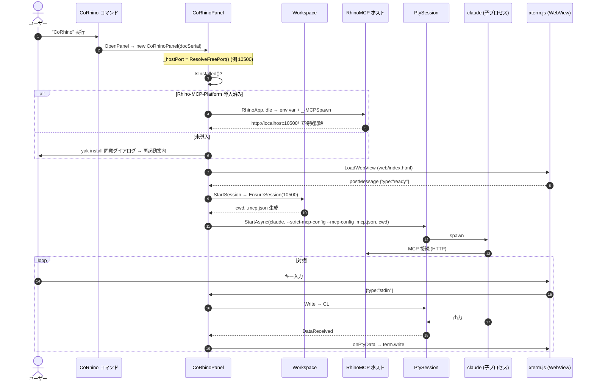
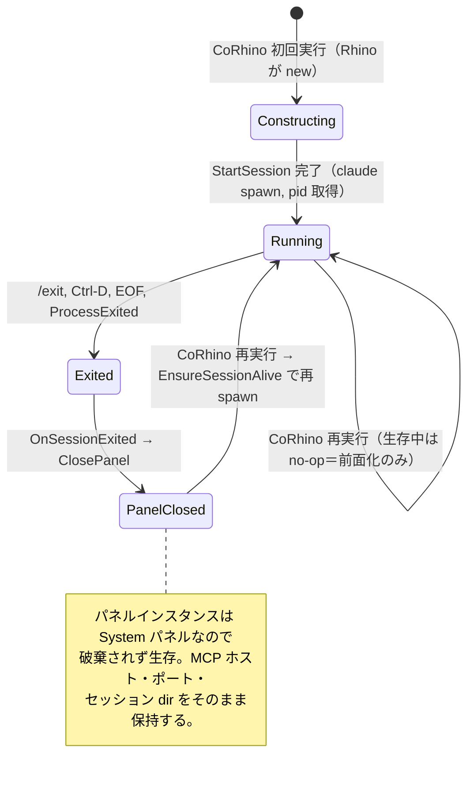

# CoRhino アーキテクチャ

新規コントリビューター（および将来の自分）が、コードを開く前に**全体像と「なぜこの形か」**を掴むためのドキュメント。
記述はすべて 2026-05-31 時点のソースを正本とし、要所に `ファイル:行` を添えた。挙動が疑わしいときは
このドキュメントではなくコードを信じること。設計の経緯・検証履歴は [`design-history.md`](design-history.md)、
利用手順は [`../README.md`](../README.md) を参照。

---

## 0. このドキュメントの読み方

- **1章**で「何を作っているか・責務境界」を掴む。ここだけ読めば概念は分かる。
- **2章**は各ファイルの責務を1つずつ（コンポーネント単位の MECE 分解）。
- **3章**は複数コンポーネントをまたぐデータフロー（プロセス境界・プロトコル・シーケンス図）。
- **4–5章**はライフサイクル／状態と、ポート分離モデル。バグの温床になりやすい所。
- **6–10章**はリファレンス（プラットフォーム差・設計判断トレース・設定一覧・内在制約・用語集）。
- 「なぜこの形か」の経緯・検証ログは [`design-history.md`](design-history.md)、今後の作業は [`roadmap.md`](roadmap.md)。

---

## 1. 全体像

### 1.1 一文での定義

> **CoRhino は、Rhino 8 のサイドパネルに Claude Code（`claude` CLI）をドックし、PTY 経由で起動した
> その `claude` を、公式 Rhino-MCP-Platform の HTTP ホストに direct-HTTP でつないで「いま開いているその
> Rhino」を操作させる C# プラグインである。**

非エンジニアが「パネルを開くだけ」で使えることが目標。`MCPConnect`／設定ファイルの貼り付け／手動の MCP
起動を一切踏ませない。

### 1.2 責務境界（最重要）

CoRhino は **インターフェースだけ**を作る。Rhino 操作の中身は持たない。

```
┌─────────────────────────────────────────────────────────────┐
│ CoRhino が持つ（このリポジトリ）                              │
│  • パネル UX（WebView + xterm.js のターミナル）               │
│  • 起動配線（claude を PTY で spawn し、MCP 設定を注入）       │
│  • ホスト MCP の自動起動（_-MCPSpawn + env var）              │
│  • オンボーディング（Rhino-MCP-Platform の yak 自動導入）     │
│  • セッションのライフサイクル管理（終了検知・再起動・分離）   │
└─────────────────────────────────────────────────────────────┘
┌─────────────────────────────────────────────────────────────┐
│ CoRhino が持たない（公式 Rhino-MCP-Platform に乗る）          │
│  • Rhino 操作の tools（run_python / list_objects / …）        │
│  • HTTP MCP サーバの実装本体                                  │
│  • agents / commands / skills                                 │
│  → vendoring（フォーク同梱）しない。McNeel が育てたものに乗る │
└─────────────────────────────────────────────────────────────┘
```

この線引きが設計判断 **D2**（→ 7章）。CoRhino にツールを実装しそうになったら、それは Rhino-MCP-Platform
側の仕事。

### 1.3 主要登場人物（プロセス／コンポーネント地図）

CoRhino は**単一の Rhino プロセス内**で完結する。外部の node router や別 Rhino プロセスは spawn しない。

```
┌───────────────────────────── Rhino 8 プロセス ─────────────────────────────┐
│                                                                            │
│   ┌──────────────────────── CoRhino プラグイン (.rhp / C#) ─────────────┐  │
│   │                                                                     │  │
│   │  CoRhinoPlugin        起動時ロード・パネル登録                       │  │
│   │  OpenCoRhinoPanelCommand   "CoRhino" コマンド＝唯一の入口            │  │
│   │                                                                     │  │
│   │  CoRhinoPanel  ──────── オーケストレータ（全部ここから配線）         │  │
│   │   │   ├─ WebView ──(JSON msg)──▶ xterm.js UI                        │  │
│   │   │   │                ▲                                            │  │
│   │   │   │           (onPtyData)                                       │  │
│   │   │   ├─ PtySession ──▶ 子プロセス: claude（or bash/cmd fallback）  │  │
│   │   │   ├─ Workspace ──▶ ~/.corhino/sessions/<port>/（cwd, .mcp.json）│  │
│   │   │   └─ RhinoMcpInstaller ──▶ yak install（未導入時のみ）          │  │
│   │   │                                                                 │  │
│   │   └─ EnsureHostMcpStarted ──(env var + _-MCPSpawn)──┐               │  │
│   └─────────────────────────────────────────────────────┼─────────────┘  │
│                                                          ▼                 │
│   ┌──────────── Rhino-MCP-Platform プラグイン (.rhp) ─────────────────┐   │
│   │   HTTP MCP ホスト  http://localhost:<port>/                       │   │
│   │   tools: run_python / run_command / list_objects / …              │   │
│   └───────────────────────────────────────────────────────────────────┘   │
│                                                          ▲                 │
└──────────────────────────────────────────────────────────┼────────────────┘
                                                            │ direct-HTTP
                       claude（子プロセス）── MCP client ───┘
```

ポイント:
- `claude` は Rhino の**子プロセス**で、PTY 経由で標準入出力がパネルにつながる。
- `claude` は同じ Rhino プロセス内で動く RhinoMCP ホストに `http://localhost:<port>/` で接続する。
- ポートは**パネル（＝Rhino インスタンス）ごとに採番**され、「どの Rhino を操作するか」を一意に固定する（→ 5章）。

---

## 2. コンポーネント詳解

プロセス内の層ごとに分割（MECE）。各節は「責務 → 要点 → 参照」の順。

### 2.1 プラグイン本体 — `CoRhinoPlugin.cs`

**責務**: Rhino 起動時にロードされ、パネル型を Rhino に登録するだけ。

- `LoadTime => AtStartup`（[CoRhinoPlugin.cs:19](../src/CoRhinoPlugin.cs#L19)）。コマンド実行を待たず起動時にロードされる。
  これにより、パネルを開く前から（厳密には初回パネル構築時から）配線できる。
- `OnLoad` で `Panels.RegisterPanel(..., typeof(CoRhinoPanel), "CoRhino", ..., "CoRhino.icon.png", PanelType.System)`
  （[CoRhinoPlugin.cs:23](../src/CoRhinoPlugin.cs#L23)）。アイコンは埋め込みリソース（csproj の `LogicalName="CoRhino.icon.png"`）。
- アセンブリ GUID: `4C13D5E0-9E5A-4F18-9C2A-1E9E1A7B3C01`（[CoRhinoPlugin.cs:6](../src/CoRhinoPlugin.cs#L6)）。
- `PanelType.System` の含意は重要 → **Rhino がパネルインスタンスをキャッシュし、閉じても `Dispose` しない**。
  これが 4 章の再起動設計の前提になる。

### 2.2 コマンド — `OpenCoRhinoPanelCommand.cs`

**責務**: ユーザーが叩く唯一のコマンド `CoRhino`。パネルを開き、必要なら claude を再起動する。

`RunCommand`（[OpenCoRhinoPanelCommand.cs:12](../src/Commands/OpenCoRhinoPanelCommand.cs#L12)）は2手:

1. `Panels.OpenPanel(typeof(CoRhinoPanel).GUID)` — パネルを開く（初回は構築、2回目以降はキャッシュを前面に）。
2. `Panels.GetPanel<CoRhinoPanel>(doc)?.EnsureSessionAlive()` — 生存インスタンスに「セッション生きてる？死んでたら再起動して」と頼む。

**なぜコマンドが再起動の入口なのか**: System パネルはキャッシュされコンストラクタが再実行されないので、`/exit` で
claude が死んだ後に「×→再オープン」しても何も起きない。再起動トリガを**コマンド再実行**に固定することで、
`Dispose` されない前提に依存せず確実に再起動できる（→ 4.2）。セッションが生きていれば `EnsureSessionAlive` は
no-op（パネルが前面に来るだけ）。

### 2.3 パネル — `CoRhinoPanel.cs`（オーケストレータ）

**責務**: 本プラグインの中心。WebView の保持、ポート採番、MCP ホスト起動、claude 起動、UI ⇄ PTY の双方向
中継、終了検知と再起動、ドキュメント切替対応——配線のほぼ全てをここが握る。

`Eto.Forms.Panel` を継承。クラス GUID `4C13D5E0-…-3C02`（[CoRhinoPanel.cs:14](../src/Panel/CoRhinoPanel.cs#L14)）。

#### 構築の流れ（コンストラクタ [CoRhinoPanel.cs:38](../src/Panel/CoRhinoPanel.cs#L38)）

Rhino がドキュメントごとに `new CoRhinoPanel(uint documentSerialNumber)` を呼ぶ（リポジトリ内に明示的な
`new` は無い＝Rhino 基盤が生成）。実行順序は次の通り。**フィールド初期化子がコンストラクタ本体より先**に走る点が肝:

```
① _session = new PtySession()                       … フィールド初期化子
② _hostPort = Workspace.ResolveFreePort()           … フィールド初期化子（★本体より前にポート確定）
③ _documentSerialNumber = documentSerialNumber      … 自分の doc を記憶（閉じるとき使う）
④ WebView 生成 + MessageReceived 購読               … DEBUG ビルドは Inspectable=true
⑤ WireSession(_session)                             … DataReceived→OnPtyData, Exited→OnSessionExited
⑥ EndOpenDocument / NewDocument 購読                … doc 切替でホスト再起動
⑦ IsInstalled() ? EnsureHostMcpStarted() : RunOnboarding()
⑧ Content = _webView; LoadWebView()
⑨ Interlocked.Exchange(_starting, 1)                … 起動完了前の二重 spawn を封じる
⑩ LaunchSessionInBackground()                       … 別スレッドで StartSession()
```

`②` のおかげで、`⑦` の MCP ホスト起動も `⑩` の `.mcp.json` 生成も**同じポートを共有**する。

#### 主要メソッド

| メソッド | 役割 | 参照 |
|---|---|---|
| `LoadWebView` | `CORHINO_WEBUI_URL` があれば dev サーバ URL を、なければ plugin dir の `web/index.html` を `LoadHtml` | [:166](../src/Panel/CoRhinoPanel.cs#L166) |
| `StartSession` | CLI 解決 → セッション dir 準備 → claude を PTY で spawn（後述） | [:188](../src/Panel/CoRhinoPanel.cs#L188) |
| `EnsureHostMcpStarted` | `RhinoApp.Idle` ワンショットで env var セット + `_-MCPSpawn` 発火 | [:242](../src/Panel/CoRhinoPanel.cs#L242) |
| `OnDocChangedRestartHost` | doc 切替/新規時、導入済みならホスト再起動 | [:279](../src/Panel/CoRhinoPanel.cs#L279) |
| `OnMessageReceived` | WebView → C# の JSON を捌く（ready/stdin/resize/debug） | [:287](../src/Panel/CoRhinoPanel.cs#L287) |
| `OnPtyData` | PTY 出力を UTF-8 化し WebView へ（未 ready ならキュー） | [:334](../src/Panel/CoRhinoPanel.cs#L334) |
| `OnSessionExited` | claude 終了 → このパネルを `ClosePanel` | [:99](../src/Panel/CoRhinoPanel.cs#L99) |
| `EnsureSessionAlive` | 死んでいれば新 PtySession を作り再 spawn | [:139](../src/Panel/CoRhinoPanel.cs#L139) |
| `Dispose` | doc イベント解除 + `_session.Dispose()` | [:359](../src/Panel/CoRhinoPanel.cs#L359) |

#### claude の起動引数（`StartSession`）

```
claude --strict-mcp-config --mcp-config <~/.corhino/sessions/<port>/.mcp.json>
```
（[CoRhinoPanel.cs:202](../src/Panel/CoRhinoPanel.cs#L202)）

- `--strict-mcp-config` … ユーザーのグローバル/プロジェクト MCP 設定を一切読まない（`~/.claude` を汚さない＝D3）。
- `--mcp-config <path>` … このセッション専用の `rhino`（http）サーバだけをロード。
- cwd は `Workspace.EnsureSession(_hostPort)` が返すセッション dir。**アクティブ `.3dm` には追従しない**（D5）。
- claude が PATH に無ければ `bash -l`（Unix）/ `cmd.exe`（Windows）へフォールバック（[:209](../src/Panel/CoRhinoPanel.cs#L209)）。
- Windows で `claudePath` が `.exe` でない（`.cmd`/`.bat` 等）場合は `cmd.exe /c <path> <args>` で起動（[:220](../src/Panel/CoRhinoPanel.cs#L220)）。

#### 出力バッファリング

WebView の準備（`ready` メッセージ）が来る前に PTY 出力が届くことがあるので、`_webReady` が立つまで
`_pendingOutput` キューに溜め、`ready` 受信時に `FlushPending` で流す（[:297](../src/Panel/CoRhinoPanel.cs#L297), [:349](../src/Panel/CoRhinoPanel.cs#L349)）。

### 2.4 ワークスペース — `Workspace.cs`

**責務**: パネル（Rhino インスタンス）ごとの作業ディレクトリと設定ファイルの生成・所有。`static` ユーティリティ。

- ベース: `~/.corhino`。セッション dir: `~/.corhino/sessions/<port>/`（[Workspace.cs:31](../src/Panel/Workspace.cs#L31)）。
- `ResolveFreePort(count=100)`（[:41](../src/Panel/Workspace.cs#L41)）: `BasePort=10500` から順に `TcpListener` で bind 試行し、
  最初に空いたポートを返す。100 個全滅なら 10500 を返す（その場合は後段の bind エラーで顕在化）。
- `EnsureSession(port)`（[:71](../src/Panel/Workspace.cs#L71)）:
  - dir を作成。
  - `CLAUDE.md` … **存在しなければ**テンプレから seed（以後ユーザー所有、上書きしない）。
  - `.mcp.json` … ポートから純粋に導出されるので**毎回上書き**（常に正しい URL に保つ）。
  - 戻り値 = セッション dir（claude の cwd）。
- `.mcp.json` の中身（[:89](../src/Panel/Workspace.cs#L89)）: サーバは1つだけ。
  ```json
  { "mcpServers": { "rhino": { "type": "http", "url": "http://localhost:<port>/" } } }
  ```
- `CLAUDE.md` テンプレ（[:108](../src/Panel/Workspace.cs#L108)）: セッションの性質（このディレクトリ＝1 Rhino インスタンス）と
  RhinoMCP 主要ツール（`run_python` 中心、`spawn_slot` 等）、進め方を日本語で説明。これが各 claude セッションの
  最初のシステム文脈になる。

### 2.5 オンボーディング — `RhinoMcpInstaller.cs`

**責務**: Rhino-MCP-Platform（yak パッケージ）が無いとき、ユーザーに `yak install` を打たせずに自動導入する（Phase 2a）。

- 導入検出 `IsInstalled()`（[:31](../src/Panel/RhinoMcpInstaller.cs#L31)）: `PlugIn.PlugInExists(PluginId, …)`。
  - `PluginId = 2668d7ed-f507-4a68-8295-8172147a0e39`（RhinoMCP の `AssemblyInfo.cs` 由来）。
  - **なぜ plugin id で見るか**: yak パッケージ dir のスキャンだと、ローカル Debug コピー（yak パッケージではない）を
    「未導入」と誤判定する。plugin id なら Rhino が登録した時点で true になり、Debug コピーも拾える。
- `RunOnboarding()`（[:39](../src/Panel/RhinoMcpInstaller.cs#L39)）: モーダルがパネル構築を止めないよう `RhinoApp.Idle` ワンショットに遅延。
- `StartOnboarding()`（[:54](../src/Panel/RhinoMcpInstaller.cs#L54)）:
  1. `ResolveYak()` で yak CLI を解決。見つからなければ手動導入を促すエラーダイアログで終了。
  2. 同意ダイアログ（Eto `MessageBox` YesNo）を**1回だけ**。No なら何もしない。
  3. Yes → `Task.Run` で**バックグラウンド** `yak install Rhino-MCP-Platform`。進捗はコマンドライン、完了/失敗は
     ネイティブダイアログ。完了時は「Rhino 再起動」を案内（yak 導入プラグインは起動時しかロードされないため）。
- `RunYakInstall`（[:105](../src/Panel/RhinoMcpInstaller.cs#L105)）: stdout/stderr を取り、120 秒タイムアウト（超過は kill）、`ExitCode==0` で成功判定。
- `ResolveYak`（[:147](../src/Panel/RhinoMcpInstaller.cs#L147)）: **実行中の Rhino に同梱された** yak を使う。
  - Windows: `RhinoApp` アセンブリと同居の `yak.exe`。
  - macOS: 実行プロセスの `MainModule`（`…/Contents/MacOS/Rhinoceros`）から `…/Contents/Resources/bin/yak`。

### 2.6 PTY セッション — `PtySession.cs`

**責務**: `Porta.Pty` で疑似端末を張り、子プロセス（claude）の spawn・入出力・終了検知・破棄を担う。
**使い捨て**（一度終了したら再 `StartAsync` せず、新インスタンスを作る）。

- `StartAsync`（[:24](../src/Pty/PtySession.cs#L24)）: 既に起動済みなら例外（再利用禁止＝使い捨ての契約）。
  - **環境は allow-list 方式**（[:31](../src/Pty/PtySession.cs#L31)）: `HOME USER LOGNAME PATH SHELL LANG LC_ALL LC_CTYPE TMPDIR` だけを
    親から引き継ぎ、呼び出し側 `env`（PATH 上書き等）をマージ、`TERM` 既定 `xterm-256color`。Rhino の汚れた環境を
    claude に丸ごと渡さない。
  - `PtyProvider.SpawnAsync` → `IPtyConnection`。`ProcessExited` を購読し `HandleExit`（[:57](../src/Pty/PtySession.cs#L57)）。
  - `ReadLoop`（[:69](../src/Pty/PtySession.cs#L69)）: 4096 バイトずつ読み `DataReceived` を発火。**EOF も終了シグナルとして扱う**
    （ホストによっては `ProcessExited` が来ないため）。
- `HandleExit`（[:101](../src/Pty/PtySession.cs#L101)）: `Interlocked` で**1回だけ**実行。接続を dispose、`_connection=null`（→ `IsRunning=false`）、
  `Exited` 発火。`ProcessExited` と EOF の二経路から呼ばれても冪等。
- `IsRunning => _connection != null`（[:22](../src/Pty/PtySession.cs#L22)）。終了検知でこれが false になることが、再起動判定の根拠。
- `Write`/`Resize`（[:109](../src/Pty/PtySession.cs#L109)）、`Dispose`（[:121](../src/Pty/PtySession.cs#L121)）: Dispose は先に「exited 済み」マークを立て、二重発火を防いでから
  CTS キャンセル・Kill・dispose。

### 2.7 CLI 解決 — `CliResolver.cs`

**責務**: `claude` 実行ファイルの絶対パスと、ログインシェルの `PATH` を解決する。

- Unix（[:21](../src/Pty/CliResolver.cs#L21)）: `bash -lc "command -v claude || which claude"` と `bash -lc 'echo -n "$PATH"'`。
  **ログインシェル経由**なのは、Rhino の PATH には nvm/homebrew 等のパスが入っていないことが多いから。
- Windows（[:28](../src/Pty/CliResolver.cs#L28)）: `where.exe claude` の結果から **`.exe` を最優先**（`.cmd` → `.bat` → 先頭）。
  - `.cmd` shim を引いたら、その中身から実体 `.exe` を正規表現で抽出して差し替える（`ResolveCmdShimTarget`, [:79](../src/Pty/CliResolver.cs#L79)）。
  - **なぜ**: `cmd.exe` を噛ませると ConPTY の ANSI シーケンス透過が乱れ、Ink ベースの claude TUI が
    チラつく／バナーが重複する。直接 `.exe` を起動すればこれを避けられる。

### 2.8 ログ — `Log.cs`

**責務**: 単純な追記ログ。`%TMPDIR%/CoRhino.log` にロック付きで追記し、同時に `RhinoApp.WriteLine` でコマンドラインにも出す
（[Log.cs:13](../src/Log.cs#L13)）。デバッグはこのファイルを `tail` するのが基本。

### 2.9 UI 層 — `ui/`（xterm.js）

**責務**: WebView 内に xterm.js のターミナルを描画し、キー入力を C# へ、PTY 出力を画面へ流す。`ui/src/main.ts` が単一エントリ。

- **ブリッジ** `post()`（[main.ts:22](../ui/src/main.ts#L22)）: 環境ごとに送信口が違う。
  - macOS WKWebView → `window.eto.postMessage`
  - Windows WebView2 → `window.chrome.webview.postMessage`
  - レガシー → `window.external.notify`
- **送信メッセージ（Outbound）**（[main.ts:16](../ui/src/main.ts#L16)）: `ready` / `stdin` / `resize` / `debug`。
- **受信窓口** `window.CoRhinoPanel`（[main.ts:182](../ui/src/main.ts#L182)）: C# 側が `ExecuteScriptAsync` で呼ぶ。
  - `onPtyData(text)` → `term.write(text)`
  - `onSessionRestart()` → `term.reset()`（再起動時に画面をクリア）
- xterm 設定: `convertEol: true`（[main.ts:104](../ui/src/main.ts#L104)）。Windows ConPTY が bare `\n` を出すと階段状になるのを、xterm 側で `\r\n` 合成して吸収。
- **macOS のキー欠落対策**（[main.ts:137](../ui/src/main.ts#L137)）: WKWebView の helper textarea 経路が高速打鍵で文字を落とす
  （"rhino"→"rhn", xterm #5374）。capture-phase の `keydown` で印字可能キーを先取りして `term.input()` に流し、
  `input`/`beforeinput` を握り潰す。IME 合成中は素通し（日本語入力を壊さない）。
- **Windows の IME 対策**（[main.ts:81](../ui/src/main.ts#L81)）: 合成中に helper textarea が伸びてパネルが横スクロールするのを、
  textarea を **1×1 px** にクランプして防ぐ（macOS では逆効果なので Windows 限定）。0×0 は xterm が「IME が壊れる」と警告する条件
  （`CompositionHelper` は `Math.max(bounds, 1)` で 1px 下限を保証）で、0×0 にすると日本語 IME が確定済みの先頭語を毎回再送する
  重複バグが出た（→ [design-history.md](design-history.md)）。1×1 は横スクロール対策と IME 動作を両立する。
- **リサイズのデバウンス**（[main.ts:198](../ui/src/main.ts#L198)）: `ResizeObserver` → 80ms デバウンス → `fit()`。
  paint→scrollbar→resize→repaint のフィードバックループを断つ。

> 補足: `ui/src/main.js` / `vite.config.js` / `tsconfig.tsbuildinfo` は `.ts` のコンパイル出力で **gitignore 済み**。
> 正本は常に `.ts`。

### 2.10 ビルドパイプライン — `CoRhino.csproj` + vite

**責務**: `dotnet build` 一発で UI ビルド・ネイティブ処理・plugin dir へのコピーまで完結させる。

- ターゲット: `net8.0` / 出力拡張子 `.rhp` / `EnableDynamicLoading`（[csproj:1](../src/CoRhino.csproj#L1)）。
- 参照: `RhinoCommon` / `Eto` / `Rhino.UI`（`Private=false`＝Rhino が供給するので同梱しない）、Unix のみ `Microsoft.macOS`。
  NuGet は `Porta.Pty 1.0.7` のみ。
- **ビルドの連鎖**:
  1. `BuildUi`（[:60](../src/CoRhino.csproj#L60)）: `ui/` で `npm install`（`node_modules` 無いときのみ）→ `npm run build`（= `tsc -b && vite build`）。
  2. `CopyWebUi`（[:68](../src/CoRhino.csproj#L68)）: `ui/dist/**` を `$(TargetDir)/web/` へコピー。`DependsOnTargets="BuildUi"` で dist の存在を保証。
  3. `FlattenNativeLibs`（AfterTargets=Build, [:76](../src/CoRhino.csproj#L76)）: **macOS は `lipo -create` で arm64+x64 を1つのユニバーサル
     `libporta_pty.dylib` に融合**（フラット化で名前衝突→片方が勝つと dlopen 失敗するのを回避）。Windows は win-x64 native をコピー。
  4. `PostBuild`（AfterTargets=PostBuildEvent, [:91](../src/CoRhino.csproj#L91)）: `$(TargetDir)/**` を plugin dir へコピー（ロック中 DLL は skip）。
- **vite 設定**（[vite.config.ts](../ui/vite.config.ts)）: `viteSingleFile` + 自作 `classicAtBodyEnd` プラグインで、`type="module"` を剥がし
  巨大インライン `<script>` を `</body>` 直前へ移動（`#terminal` が DOM に存在してから走るように）。出力は iife。
  → **成果物は単一 HTML**。C# 側は `web/index.html` を `ReadAllText` して `LoadHtml` するだけで済む。
- **配置先（PluginDestDir）**:
  - macOS: `~/Library/Application Support/McNeel/Rhinoceros/8.0/MacPlugIns/CoRhino`
  - Windows: `%APPDATA%\McNeel\Rhinoceros\myplugins\CoRhino`
  - ⚠ コピー先を直接編集しないこと。必ず再ビルドで反映する。

---

## 3. 横断する仕組み（データフロー）

### 3.1 4つのプロセス／境界

CoRhino は内部に4つの通信境界を持つ。バグはたいていこの境界で起きる。

```
[1] WebView ⇄ C#      JSON 文字列（postMessage / ExecuteScriptAsync）
[2] C# ⇄ PTY          バイト列（stdin 書き込み / ReaderStream 読み出し）
[3] C# → RhinoMCP host RhinoApp.RunScript("_-MCPSpawn") + env var（同プロセス内コマンド）
[4] claude ⇄ host      HTTP（MCP, http://localhost:<port>/）— C# は関与しない
```

### 3.2 メッセージプロトコル（境界 [1]: WebView ⇄ C#）

**UI → C#（Outbound, `OnMessageReceived` が受信）**

| `type` | ペイロード | C# の処理 |
|---|---|---|
| `ready` | — | `_webReady=true` → `FlushPending()` |
| `stdin` | `data: string` | UTF-8 で `_session.Write()`（PTY へ） |
| `resize` | `cols, rows: number` | `_session.Resize(cols, rows)` |
| `debug` | `message: string` | `Log.Write("[Claude/UI] …")` |

**C# → UI（`ExecuteScriptAsync` で `window.CoRhinoPanel` を呼ぶ）**

| 呼び出し | UI の処理 |
|---|---|
| `onPtyData(text)` | `term.write(text)`（PTY 出力を描画） |
| `onSessionRestart()` | `term.reset()`（再起動時に画面クリア） |

### 3.3 起動シーケンス（初回 `CoRhino` 実行）



### 3.4 入出力ループ（定常状態）

- **入力**: キー → xterm `onData` → `post({type:"stdin"})` → `OnMessageReceived` → `_session.Write(UTF8)` → claude stdin。
- **出力**: claude stdout → PTY `ReaderStream` → `ReadLoop` → `DataReceived` → `OnPtyData` → `ExecuteScriptAsync("onPtyData")` → `term.write`。
- **リサイズ**: xterm `onResize` → `post({type:"resize"})` → `_session.Resize(cols,rows)` → PTY → claude が再描画。

> 入力・出力の各ステップを `ファイル:行` 付きで追ったコード単位の深掘りは [`details/io-flow-xterm-pty.md`](details/io-flow-xterm-pty.md) を参照
> （UTF-8 のチャンク境界問題など、ここでは触れない細部まで扱う）。

### 3.5 MCP 接続経路（境界 [4]）

claude は CoRhino が生成した `.mcp.json` だけを見て（`--strict-mcp-config`）、`rhino` サーバ
（`http://localhost:<port>/`）に HTTP で接続する。**この接続自体に C# は関与しない**——CoRhino の役目は
「正しいポートを指す設定を置く」「そのポートでホストを起動する」までで、あとは claude と RhinoMCP ホストの
HTTP 対話。ツール名前空間は `mcp__rhino__*`（[`design-history.md`](design-history.md) の実機検証 S1 で確認済み）。

---

## 4. ライフサイクルと状態

### 4.1 パネル／セッションの状態遷移



### 4.2 終了と再起動（設計の核心）

**問題**: かつて `/exit` でパネルが無言で固まり、開き直しても再起動しなかった。原因は2つの相互作用——
(a) `PtySession` が終了後も `_connection` を保持し `IsRunning` が true のままだった、
(b) System パネルはキャッシュされ `Dispose` されないのでコンストラクタ（＝1回限りの `StartSession`）が再実行されない。

**現在の解（コードで確認できる事実）**:

1. **終了検知の一元化** — `PtySession.HandleExit` を `ProcessExited` と ReadLoop の EOF 両方から呼び、
   `Interlocked` で1回だけ実行。接続を dispose し `IsRunning=false`、`Exited` 発火（[PtySession.cs:101](../src/Pty/PtySession.cs#L101)）。
2. **パネル自動クローズ** — `OnSessionExited` が `RhinoDoc.FromRuntimeSerialNumber(_documentSerialNumber)` で
   **自分の doc** を解決し `Panels.ClosePanel(GUID, doc)`（[CoRhinoPanel.cs:99](../src/Panel/CoRhinoPanel.cs#L99)）。`ActiveDoc` に頼ると複数 doc で別パネルを誤って閉じる。
3. **再起動はコマンド再実行が入口** — `CoRhino` → `EnsureSessionAlive`。`IsRunning` なら no-op、死んでいれば
   **古い session を Dispose して新 `PtySession` を生成・再配線**して再 spawn（[CoRhinoPanel.cs:139](../src/Panel/CoRhinoPanel.cs#L139)）。
4. **MCP ホスト・ポート・セッション dir は再利用** — `_hostPort` はパネル存続中そのまま。再 Spawn 不要。
   再起動時のみ `onSessionRestart()`（`term.reset()`）で画面をクリーンにする。

### 4.3 ドキュメント切替時のホスト再起動

RhinoMCP ホストは**ドキュメント単位**。`EndOpenDocument` / `NewDocument` で `OnDocChangedRestartHost` が走り、
導入済みなら `EnsureHostMcpStarted()` を再発火する（[CoRhinoPanel.cs:279](../src/Panel/CoRhinoPanel.cs#L279)）。`_-MCPSpawn` は `StartOrRestart` 意味論なので
再発火は安全。オンボーディング中（未導入）は `IsInstalled()` ガードで何もしない。

### 4.4 並行性と再入防止

- `_starting`（`Interlocked`, [CoRhinoPanel.cs:23](../src/Panel/CoRhinoPanel.cs#L23)）: 起動直後（spawn 完了前）の `CoRhino` 連打や再起動中の二重 spawn を防ぐ。
  コンストラクタで 1 をセットし、`LaunchSessionInBackground` の `finally` で 0 に戻す。`EnsureSessionAlive` は
  `Interlocked.Exchange(_starting,1) != 0` なら即 return（誰かが起動中なら譲る）。
- `_exitedRaised`（`Interlocked`, PtySession）: `Exited` の二重発火を防ぐ。
- スレッド境界: `StartSession` はバックグラウンドスレッド。UI への反映は `Application.Instance.AsyncInvoke` で
  必ず UI スレッドに戻す（`OnPtyData` / `OnSessionExited` / `EnsureSessionAlive` の term.reset）。
- `RhinoApp.RunScript` / モーダルは `RhinoApp.Idle` ワンショットに遅延し、コマンドのネスト実行を避ける
  （ネストすると `_-MCPSpawn` が失敗しホストが上がらない、というバグ B1 の対策）。

---

## 5. ポート／セッション分離モデル（per-instance）

**なぜ重要か**: Rhino を2つ並べる（macOS では実プロセスは1つ、新規ドキュメント＝別ウィンドウ＋別パネル）と、
全パネルが固定ポートで MCP 起動・接続すると、**B のパネルの指示が A に反映される**という混線が起きる。

**現在の解（D6）**:

```
パネル A (doc1)                          パネル B (doc2)
  _hostPort = 10500                        _hostPort = 10501   ← ResolveFreePort で別ポート
  cwd = ~/.corhino/sessions/10500/         cwd = ~/.corhino/sessions/10501/
  .mcp.json → localhost:10500/             .mcp.json → localhost:10501/
  _-MCPSpawn (RHINO_MCP_AUTOSTART_PORT=10500)  _-MCPSpawn (…=10501)
        │                                        │
        ▼                                        ▼
  host @ 10500 (doc1 バインド)             host @ 10501 (doc2 バインド)
        ▲                                        ▲
  claude A ────────┘                       claude B ────────┘
```

- ポートは**パネル単位で採番**（`ResolveFreePort`、10500 から最初の空き）。
- cwd を `sessions/<port>/` に分けたことで、claude のセッション履歴（`~/.claude/projects/<cwd>`）も
  per-instance に分離され、並行セッションが干渉しない。
- `RHINO_MCP_AUTOSTART_PORT` をセットすると **plugin 側の doc-open autostart が抑止**されるので、ポート所有が一意になる。
- 実機検証（plan doc, 2026-05-31）: 2 ドキュメント／2 パネルで、各 claude が自分のドキュメントにだけ反映されることを確認。

---

## 6. プラットフォーム差異（macOS / Windows）

| 観点 | macOS | Windows |
|---|---|---|
| WebView ブリッジ | `window.eto.postMessage`（WKWebView） | `window.chrome.webview.postMessage`（WebView2） |
| claude 解決 | `bash -lc "command -v claude"` | `where.exe claude`（`.exe` 優先、`.cmd` は実体 `.exe` に解決） |
| claude 起動 | 直接 spawn | `.exe` は直接、それ以外は `cmd.exe /c` 経由 |
| フォールバック | `bash -l` | `cmd.exe` |
| ネイティブ dylib | `lipo` で arm64+x64 ユニバーサル化 | win-x64 native をコピー |
| yak の場所 | `<Rhino.app>/Contents/Resources/bin/yak` | Rhino System dir の `yak.exe` |
| 改行 | PTY が `\n`→`\r\n` 変換 | ConPTY は変換しない → xterm `convertEol` で吸収 |
| キー入力 | helper textarea 欠落対策（keydown 先取り） | 既定経路 + IME 用 textarea クランプ |
| plugin dir | `~/Library/.../MacPlugIns/CoRhino` | `%APPDATA%\McNeel\Rhinoceros\myplugins\CoRhino` |

---

## 7. 確定した設計判断（D1–D6）とトレース

各判断が**どのコードに現れるか**まで対応づける（判断の詳細な理由・経緯は [`design-history.md`](design-history.md)）。

| ID | 判断 | 理由（要約） | 現れる場所 |
|---|---|---|---|
| **D1** | 接続は direct-HTTP（node router を使わない） | パネルの意味論は「ドックされたこの Rhino を操作」。router の利点はこのトポロジーで全て無効 | `Workspace.McpConfigTemplate`（http サーバ1つ） |
| **D2** | ツールを持たない・vendoring しない | 公式が育てるものに乗る。フォーク保守を発生させない | リポジトリにツール実装が存在しない（責務境界） |
| **D3** | 設定はセッション単位で注入、`~/.claude` を汚さない | Rhino から開いた claude のときだけ rhino ツールが付くのが自然 | `--strict-mcp-config --mcp-config`（CoRhinoPanel.cs:202） |
| **D4** | ホスト MCP はパネルが自動起動 | ユーザーにコマンドを打たせない | `EnsureHostMcpStarted`（_-MCPSpawn + env var） |
| **D5** | claude の cwd は固定（アクティブ `.3dm` に追従しない） | 設定を一元化し挙動を読めるようにする | `Workspace.EnsureSession` が返す sessions dir |
| **D6** | ホスト MCP ポートと cwd を per-instance 化（D5 の固定を改訂） | 複数 Rhino での混線を防ぐ | `ResolveFreePort` / `sessions/<port>/` / `_hostPort` |

**MCP ホスト起動の落とし穴（バグ B3）**: `_-MCPStart <port>` は `GetInteger` で対話的にポートを取るため、
runscript からポートを渡せず「不明なコマンド: <port>」が漏れてホストが上がらなかった。RhinoMCP 側はこの racy な
経路を嫌って `_-MCPSpawn`（hidden ScriptRunner）+ `RHINO_MCP_AUTOSTART_PORT` を用意しており、CoRhino は**必ず後者**を使う。

---

## 8. 設定・環境変数・パス（リファレンス）

**環境変数**

| 変数 | 向き | 役割 |
|---|---|---|
| `CORHINO_WEBUI_URL` | CoRhino が読む | セットすると WebView が dev サーバ URL を読む（UI 開発用）。未設定なら `web/index.html` |
| `RHINO_MCP_AUTOSTART_PORT` | CoRhino が**書く** | RhinoMCP ホストの待受ポートを指定（`_-MCPSpawn` が読む）。plugin の doc-open autostart も抑止 |
| `PATH` ほか allow-list | CoRhino が claude へ渡す | `HOME USER LOGNAME PATH SHELL LANG LC_ALL LC_CTYPE TMPDIR` + `TERM` のみ |

**パス**

| パス | 内容 |
|---|---|
| `~/.corhino/sessions/<port>/` | claude の cwd（per-instance） |
| `~/.corhino/sessions/<port>/.mcp.json` | rhino(http) サーバ定義。毎回上書き |
| `~/.corhino/sessions/<port>/CLAUDE.md` | セッション文脈。初回 seed 後はユーザー所有 |
| `%TMPDIR%/CoRhino.log` | 追記ログ |
| `<plugin dir>/web/index.html` | バンドル済み UI（単一 HTML） |

**ポート**: base `10500`、`ResolveFreePort` が 10500–10599 を順に試行。

**GUID**

| GUID | 対象 |
|---|---|
| `4C13D5E0-…-3C01` | プラグインアセンブリ |
| `4C13D5E0-…-3C02` | CoRhinoPanel（パネル型） |
| `2668d7ed-f507-4a68-8295-8172147a0e39` | Rhino-MCP-Platform（導入検出用） |

---

## 9. 既知の制約

現在の構造に**内在する**制約（仕様として今そうなっている点）。**未実装機能・今後の改善作業**は
[`roadmap.md`](roadmap.md) に集約している。

- **yak 導入後の即時利用不可**: yak 導入プラグインは起動時しかロードされないため、導入後は Rhino 再起動が必須。
- **ポート枯渇時の挙動**: `ResolveFreePort` は 10500–10599 を試行し、全滅すると 10500 を返すだけ
  （後段の bind エラーで顕在化）。改善 UX は roadmap 参照。
- **マルチバイト境界**: PTY 出力は 4096 バイトのチャンク単位で UTF-8 デコードされ、文字が境界をまたぐと
  化け得る（詳細は [`details/io-flow-xterm-pty.md`](details/io-flow-xterm-pty.md)）。

---

## 10. 用語集

- **PTY (pseudo-terminal)**: プログラムに「本物の端末につながっている」と錯覚させる擬似端末。claude のような
  TUI を正しく動かすのに必要。CoRhino は `Porta.Pty` を使う。
- **MCP (Model Context Protocol)**: claude が外部ツール（ここでは Rhino 操作）を呼ぶためのプロトコル。
  CoRhino は HTTP トランスポートの `rhino` サーバ1つだけを claude に渡す。
- **direct-HTTP**: claude が `http://localhost:<port>/` の MCP ホストに直接つなぐ方式。間に node router を挟まない（D1）。
- **RhinoMCP ホスト**: Rhino-MCP-Platform が同一 Rhino プロセス内で立てる HTTP MCP サーバ。実際の Rhino 操作はここが行う。
- **yak**: Rhino のパッケージマネージャ CLI。CoRhino は Rhino-MCP-Platform の自動導入に使う。
- **System パネル**: Rhino がインスタンスをキャッシュし閉じても破棄しないパネル種別。再起動設計の前提（4.2）。
- **`_-MCPSpawn`**: RhinoMCP の hidden コマンド。`RHINO_MCP_AUTOSTART_PORT` を読んで HTTP ホストを起動する。
  対話入力を要する `_-MCPStart` の代わりに使う（B3）。
