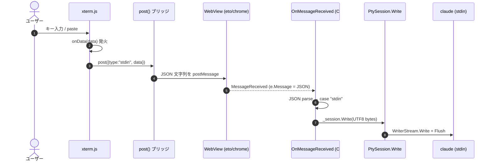
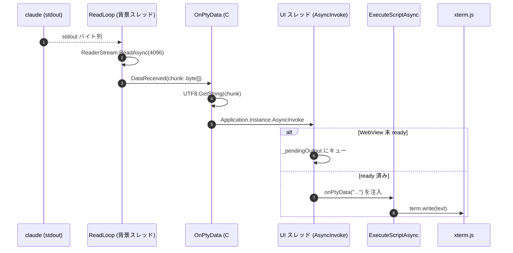

# 入出力フロー: xterm ⇄ PTY

xterm.js（WebView 内 UI）で入力したテキストが PTY（＝claude の stdin）へ流れる過程と、PTY の出力が xterm へ
反映される過程を、コードを正本として追ったもの。記述はすべて `ファイル:行` 付き（2026-05-31 時点）。

この2方向は**経路が非対称**である点が最大のポイント:
- 入力は **JSON を `postMessage`** で C# に渡す。
- 出力は **JS 関数呼び出しを文字列で注入**（`ExecuteScriptAsync`）して UI に渡す。

全体のアーキテクチャは [`architecture.md`](../architecture.md)（特に 3.2〜3.4）を参照。

---

## 方向①: xterm の入力 → PTY（claude の stdin）

### 全体の流れ



### ステップ詳解

1. **`onData` が唯一の入口** — xterm は確定した入力文字列を `onData` で出す。
   `term.onData((data) => post({ type: 'stdin', data }))`（[main.ts:126](../../ui/src/main.ts#L126)）。
   ここに来るのは「タイプした文字」「ペースト」「IME 確定後の文字列」「制御キー（矢印 = ESC シーケンス等）」すべて。

   - **macOS の特殊経路**: WKWebView の helper textarea が高速打鍵で文字を落とす不具合（"rhino"→"rhn"）への対策として、
     capture-phase の `keydown` で印字可能キーを先取りし `term.input(e.key, true)` に流す（[main.ts:156-162](../../ui/src/main.ts#L156)）。
     `term.input()` は内部的に `onData` を発火させるので、**入口が `onData` に一本化される点は変わらない**。
     同時に textarea の `input`/`beforeinput` を握り潰し（[main.ts:172-179](../../ui/src/main.ts#L172)）、二重入力（"rrhhiinnoo"）を防ぐ。IME 合成中は素通し。
   - Windows/WebView2 は xterm 既定経路（textarea → onData）。

2. **ブリッジ選択 `post()`** — 環境ごとに送信口が違うのを吸収（[main.ts:22-45](../../ui/src/main.ts#L22)）。
   `JSON.stringify({type:'stdin', data})` した文字列を、
   - macOS → `window.eto.postMessage(s)`（WKWebView）
   - Windows → `window.chrome.webview.postMessage(s)`（WebView2）
   - レガシー → `window.external.notify(s)`

3. **C# 側の受信** — コンストラクタで購読した `_webView.MessageReceived += OnMessageReceived`（[CoRhinoPanel.cs:42](../../src/Panel/CoRhinoPanel.cs#L42)）。
   `OnMessageReceived` が `e.Message`（JSON 文字列）を `JsonDocument.Parse` し、`type` で分岐（[CoRhinoPanel.cs:287](../../src/Panel/CoRhinoPanel.cs#L287)）。
   `case "stdin"` で `data` を取り出し、**UTF-8 でバイト列化**して PTY へ:
   ```csharp
   _session.Write(Encoding.UTF8.GetBytes(s));   // CoRhinoPanel.cs:308
   ```

4. **PTY への書き込み** — `PtySession.Write`（[PtySession.cs:109](../../src/Pty/PtySession.cs#L109)）が PTY マスターの書き込み側へ:
   ```csharp
   _connection.WriterStream.Write(data, 0, data.Length);
   _connection.WriterStream.Flush();
   ```
   `_connection` は `Porta.Pty` の `IPtyConnection`。`WriterStream` に書いたバイトが claude プロセスの **stdin** に届く。
   `_connection == null`（セッション未起動/終了済み）なら黙って捨てる（[PtySession.cs:111](../../src/Pty/PtySession.cs#L111)）。

---

## 方向②: PTY の出力 → xterm

### 全体の流れ



### ステップ詳解

1. **読み取りループ** — `StartAsync` が背景スレッドで `ReadLoop` を回す（[PtySession.cs:66](../../src/Pty/PtySession.cs#L66)）。
   4096 バイトのバッファで PTY マスターの読み取り側を読む:
   ```csharp
   int read = await _connection.ReaderStream.ReadAsync(buffer, 0, buffer.Length, ct);  // PtySession.cs:77
   if (read <= 0) break;          // EOF → 終了扱い（HandleExit）
   var chunk = new byte[read];
   Array.Copy(buffer, chunk, read);
   DataReceived?.Invoke(chunk);   // PtySession.cs:81
   ```
   claude が出す表示（ANSI エスケープ込み）がこの生バイト列。

2. **イベント配線** — `WireSession` で `session.DataReceived += OnPtyData`（[CoRhinoPanel.cs:91](../../src/Panel/CoRhinoPanel.cs#L91)）。
   `DataReceived` は**背景スレッド**で発火するので、ここから UI スレッドへ戻す必要がある。

3. **C# → UI への中継 `OnPtyData`**（[CoRhinoPanel.cs:334](../../src/Panel/CoRhinoPanel.cs#L334)）:
   ```csharp
   var s = Encoding.UTF8.GetString(data);              // バイト→文字列
   Application.Instance?.AsyncInvoke(() =>              // UI スレッドへマーシャリング
   {
       if (!_webReady) { _pendingOutput.Enqueue(s); return; }   // ready 前はキュー
       var encoded = JsonSerializer.Serialize(s);      // JS 文字列リテラルに安全変換
       _ = _webView.ExecuteScriptAsync($"window.CoRhinoPanel?.onPtyData({encoded})");
   });
   ```
   - **`JsonSerializer.Serialize(s)`** が肝。出力文字列を JSON 文字列（＝ JS の文字列リテラル）にエスケープして、
     `onPtyData("...")` という**実行 JS コードに埋め込む**。これにより改行・引用符・ANSI 制御文字が壊れずに渡る。
   - 入力が「JSON を postMessage」だったのに対し、**出力は「JS 関数呼び出しを文字列で注入」** という非対称な経路。
     C#→JS を呼ぶ標準手段が `ExecuteScriptAsync`（任意 JS を実行）だから。

4. **WebView 準備前のバッファリング** — claude は WebView の `ready` 通知より早く出力し始めることがある。
   `_webReady` が立つまで `_pendingOutput` キューに溜め、`ready` 受信時に `FlushPending` でまとめて流す
   （[CoRhinoPanel.cs:297](../../src/Panel/CoRhinoPanel.cs#L297), [:349](../../src/Panel/CoRhinoPanel.cs#L349)）。これで起動直後のバナー出力が欠けない。

5. **UI 側で描画** — 注入された JS が `window.CoRhinoPanel.onPtyData` を呼ぶ（[main.ts:183](../../ui/src/main.ts#L183)）:
   ```ts
   onPtyData(text: string) { term.write(text) }
   ```
   `term.write` が ANSI エスケープを解釈してターミナルに描画する。`convertEol: true`（[main.ts:104](../../ui/src/main.ts#L104)）で、
   Windows ConPTY が出す bare `\n` を `\r\n` に合成し階段化を防ぐ。

---

## 2方向の対比

| | 入力（xterm→PTY） | 出力（PTY→xterm） |
|---|---|---|
| トランスポート | `postMessage`（JSON 文字列） | `ExecuteScriptAsync`（JS 関数呼び出しを注入） |
| データ形式 | 文字列 →**UTF-8 バイト**化して PTY へ | **UTF-8 バイト**→文字列化して JS へ |
| スレッド | WebView コールバック（UI スレッド）→ そのまま Write | 背景 ReadLoop →`AsyncInvoke`で UI スレッドへ |
| 入口の一本化 | `onData`（macOS 先取りも最終的に onData） | `term.write` |
| バッファリング | なし | `_webReady` 前は `_pendingOutput` |

---

## 正確さのために挙げる注意点（コード上の事実）

- **マルチバイト文字の境界割れ**: `ReadLoop` は 4096 バイト単位で読み、`OnPtyData` が**チャンクごとに独立して**
  `Encoding.UTF8.GetString(data)` する（[CoRhinoPanel.cs:336](../../src/Panel/CoRhinoPanel.cs#L336)）。日本語など複数バイト文字が 4096 境界をまたぐと、
  そのチャンク端で文字化けし得る。現状コードにはチャンク跨ぎのバイト保持（デコーダの状態保持）が無い。
  実用上は claude の出力単位が小さく顕在化しにくいが、**設計上の弱点として残っている**。
- **入力時のバイト境界は問題にならない**: 入力は文字列全体を一括 `GetBytes` してから書くので割れない。
- **終了直後の入力は捨てられる**: `Write` は `_connection==null` を黙殺するので、セッション終了直後に届いた入力は
  破棄される（再起動は別経路 ＝ `EnsureSessionAlive`）。
