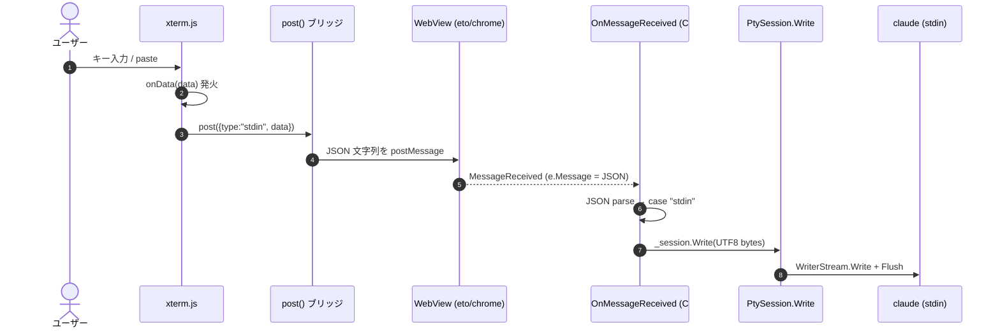
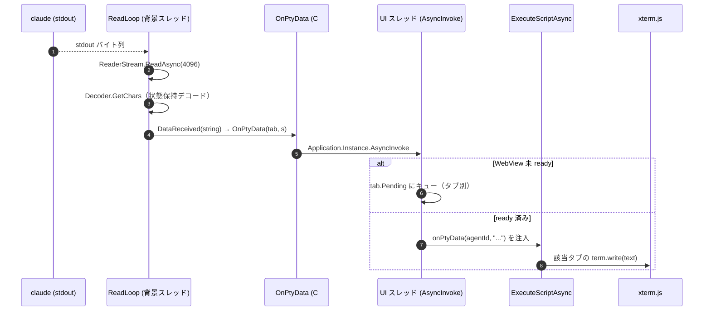

# 入出力フロー: xterm ⇄ PTY

xterm.js（WebView 内 UI）で入力したテキストが PTY（＝claude の stdin）へ流れる過程と、PTY の出力が xterm へ
反映される過程を、コードを正本として追ったもの。記述はすべて `ファイル:行` 付き（2026-06-03 時点）。

この2方向は**経路が非対称**である点が最大のポイント:
- 入力は **JSON を `postMessage`** で C# に渡す。
- 出力は **JS 関数呼び出しを文字列で注入**（`ExecuteScriptAsync`）して UI に渡す。

**タブ多重化（D7）**: 1パネルは複数タブ＝複数 claude を並列に持つため、入出力メッセージは
**`agentId` でどのタブ宛か**を区別する。入力 `{type:'stdin', agentId, data}`、出力 `onPtyData(agentId, text)`。
C# 側は `Dictionary<string, AgentTab> _tabs` で agentId → PtySession を引く。以下は1タブ分の流れを追うが、
各ステップに agentId が乗る点だけ全タブ共通。

全体のアーキテクチャは [`architecture.md`](../architecture.md)（特に 3.2〜3.4、5.2）を参照。

---

## 方向①: xterm の入力 → PTY（claude の stdin）

### 全体の流れ



### ステップ詳解

1. **`onData` が唯一の入口** — xterm は確定した入力文字列を `onData` で出す。各タブ生成時に
   `term.onData((data) => post({ type: 'stdin', agentId, data }))` を**そのタブの agentId を閉じ込めて**配線する
   （`addTab` 内, [main.ts](../../ui/src/main.ts)）。ここに来るのは「タイプした文字」「ペースト」「IME 確定後の文字列」
   「制御キー（矢印 = ESC シーケンス等）」すべて。

   - **macOS の特殊経路**: WKWebView の helper textarea が高速打鍵で文字を落とす不具合（"rhino"→"rhn"）への対策として、
     capture-phase の `keydown` で印字可能キーを先取りし**アクティブタブの** `term.input(e.key, true)` に流す。
     `term.input()` は内部的に `onData` を発火させるので、**入口が `onData` に一本化される点は変わらない**。
     同時に textarea の `input`/`beforeinput` を握り潰し、二重入力（"rrhhiinnoo"）を防ぐ。IME 合成中は素通し。
     フォーカスは常にアクティブタブのみなので、リスナーは `activeTab` を都度解決する。
   - Windows/WebView2 は xterm 既定経路（textarea → onData）。

2. **ブリッジ選択 `post()`** — 環境ごとに送信口が違うのを吸収（[main.ts:22-45](../../ui/src/main.ts#L22)）。
   `JSON.stringify({type:'stdin', data})` した文字列を、
   - macOS → `window.eto.postMessage(s)`（WKWebView）
   - Windows → `window.chrome.webview.postMessage(s)`（WebView2）
   - レガシー → `window.external.notify(s)`

3. **C# 側の受信** — コンストラクタで購読した `_webView.MessageReceived += OnMessageReceived`。
   `OnMessageReceived` が `e.Message`（JSON 文字列）を `JsonDocument.Parse` し、`type` で分岐。
   `case "stdin"` で `TryGetTab(root, out tab)` が **`agentId` から該当タブを引き**、`data` を取り出して
   **UTF-8 でバイト列化**しそのタブの PTY へ:
   ```csharp
   stdinTab.Session.Write(Encoding.UTF8.GetBytes(s));
   ```
   未知の agentId（既に閉じたタブ等）は黙ってドロップされる。

4. **PTY への書き込み** — `PtySession.Write`（[PtySession.cs:109](../../src/Pty/PtySession.cs#L109)）が PTY マスターの書き込み側へ:
   ```csharp
   _connection.WriterStream.Write(data, 0, data.Length);
   _connection.WriterStream.Flush();
   ```
   `_connection` は `Porta.Pty` の `IPtyConnection`。`WriterStream` に書いたバイトが claude プロセスの **stdin** に届く。
   `_connection == null`（セッション未起動/終了済み）なら黙って捨てる（[PtySession.cs:111](../../src/Pty/PtySession.cs#L111)）。

---

## 方向②: PTY の出力 → xterm

### 全体の流れ



### ステップ詳解

1. **読み取りループ** — `StartAsync` が背景スレッドで `ReadLoop` を回す（[PtySession.cs](../../src/Pty/PtySession.cs)）。
   4096 バイトのバッファで PTY マスターの読み取り側を読み、**その場で状態保持デコード**して文字列で発火する:
   ```csharp
   var decoder = Encoding.UTF8.GetDecoder();   // チャンク跨ぎの部分バイト列を保持
   ...
   int read = await _connection.ReaderStream.ReadAsync(buffer, 0, buffer.Length, ct);
   if (read <= 0) break;          // EOF → 終了扱い（HandleExit）
   int n = decoder.GetChars(buffer, 0, read, chars, 0);
   if (n > 0) DataReceived?.Invoke(new string(chars, 0, n));
   ```
   claude が出す表示（ANSI エスケープ込み）がこのストリーム。デコードを ReadLoop 内の `Decoder`
   インスタンスで行うのは、マルチバイト UTF-8 が 4096 境界をまたいでも文字を壊さないため
   （チャンクごとの `GetString` は境界の文字を U+FFFD 化する — design-history B10 参照）。

2. **イベント配線** — `WireSession(tab)` で `tab.Session.DataReceived += data => OnPtyData(tab, data)`。
   その PtySession のタブ実体を閉じ込めて配線するので、出力がどのタブ由来か常に判る。
   `DataReceived` は**背景スレッド**で発火するので、ここから UI スレッドへ戻す必要がある。

3. **C# → UI への中継 `OnPtyData(tab, s)`**（`s` はデコード済み文字列で届く）:
   ```csharp
   Application.Instance?.AsyncInvoke(() =>              // UI スレッドへマーシャリング
   {
       if (!_tabs.TryGetValue(agentId, out var tab)) return;    // 既に閉じたタブは捨てる
       if (!_webReady) { tab.Pending.Enqueue(s); return; }      // ready 前はタブ別キュー
       WriteToTab(agentId, s);                          // onPtyData(agentId, s) を注入
   });
   ```
   - `WriteToTab` が `JsonSerializer.Serialize` で agentId と本文を JS 文字列リテラルに安全変換し、
     `window.CoRhinoPanel?.onPtyData(<id>, <text>)` という**実行 JS コードに埋め込む**。これで改行・引用符・
     ANSI 制御文字が壊れずに渡る。
   - 入力が「JSON を postMessage」だったのに対し、**出力は「JS 関数呼び出しを文字列で注入」** という非対称な経路。
     C#→JS を呼ぶ標準手段が `ExecuteScriptAsync`（任意 JS を実行）だから。

4. **WebView 準備前のバッファリングはタブ別** — claude は WebView の `ready` 通知（やタブ生成）より早く出力し
   始めることがある。`_webReady` が立つまで**そのタブの `tab.Pending`** キューに溜め、`ready` 受信時に各タブを
   `onTabCreated` で announce してから `FlushPending(tab)` でまとめて流す。これで起動直後のバナー出力が欠けない。

5. **UI 側で描画** — 注入された JS が `window.CoRhinoPanel.onPtyData(agentId, text)` を呼ぶ:
   ```ts
   onPtyData(agentId, text) { tabs.get(agentId)?.term.write(text) }
   ```
   該当タブの `term.write` が ANSI エスケープを解釈して描画する。`convertEol: true` で、Windows ConPTY が出す
   bare `\n` を `\r\n` に合成し階段化を防ぐ。

---

## 2方向の対比

| | 入力（xterm→PTY） | 出力（PTY→xterm） |
|---|---|---|
| トランスポート | `postMessage`（JSON 文字列） | `ExecuteScriptAsync`（JS 関数呼び出しを注入） |
| データ形式 | 文字列 →**UTF-8 バイト**化して PTY へ | **UTF-8 バイト**→文字列化して JS へ |
| スレッド | WebView コールバック（UI スレッド）→ そのまま Write | 背景 ReadLoop →`AsyncInvoke`で UI スレッドへ |
| 入口の一本化 | `onData`（macOS 先取りも最終的に onData） | `term.write` |
| バッファリング | なし | `_webReady` 前は `tab.Pending`（タブ別） |
| タブ多重化 | `{type:'stdin', agentId, …}` で振り分け | `onPtyData(agentId, …)` で振り分け |

---

## 正確さのために挙げる注意点（コード上の事実）

- **マルチバイト文字の境界割れは解消済み（B10）**: かつては `OnPtyData` がチャンクごとに独立して
  `GetString` しており、4096 境界をまたぐ文字が U+FFFD 化して **TUI のレイアウト自体を壊していた**
  （罫線 `─`×63 = 189 バイトの連続 3 バイト文字が境界を踏むと行が伸び、折り返しで ink の行勘定が狂う）。
  現在は `ReadLoop` 内の `Encoding.UTF8.GetDecoder()` が部分バイト列をチャンク跨ぎで保持する。
- **入力時のバイト境界は問題にならない**: 入力は文字列全体を一括 `GetBytes` してから書くので割れない。
- **終了直後の入力は捨てられる**: `Write` は `_connection==null` を黙殺するので、セッション終了直後に届いた入力は
  破棄される（再起動は別経路 ＝ `EnsureSessionAlive`）。
- **未知 agentId のドロップ**: 既に閉じたタブ宛の `stdin`/出力は、`_tabs` に無いため黙って捨てられる
  （タブの×やプロセス終了と入出力が競合してもクラッシュしない）。
