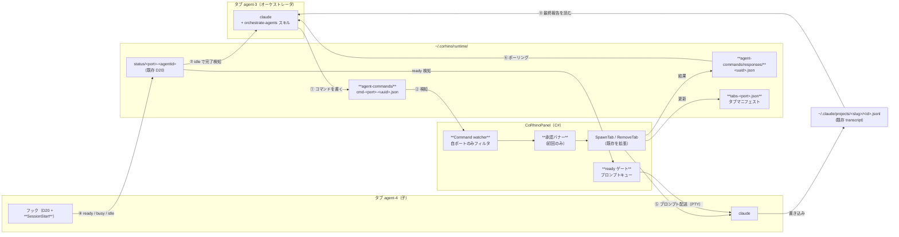
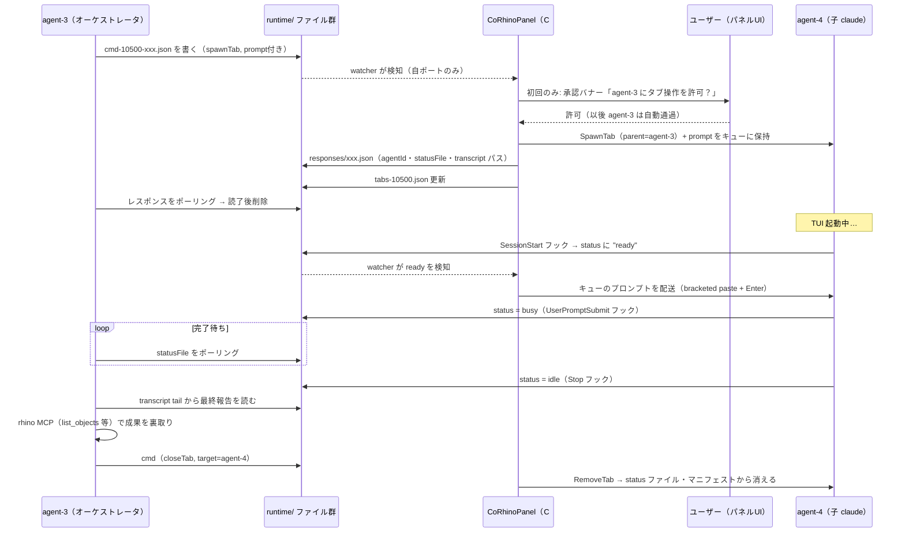
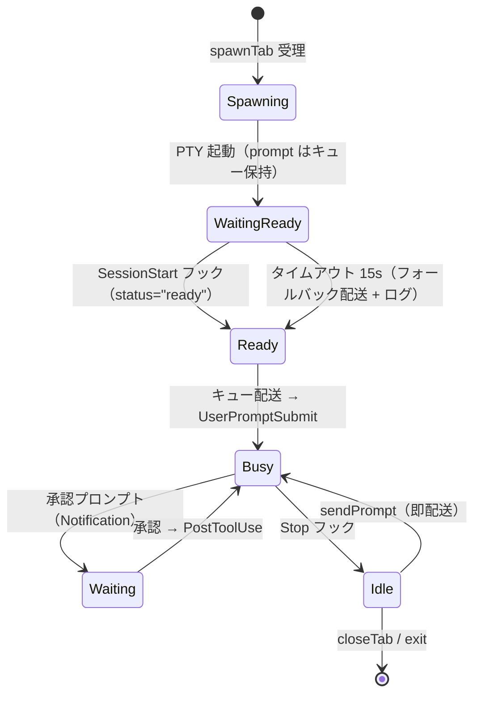
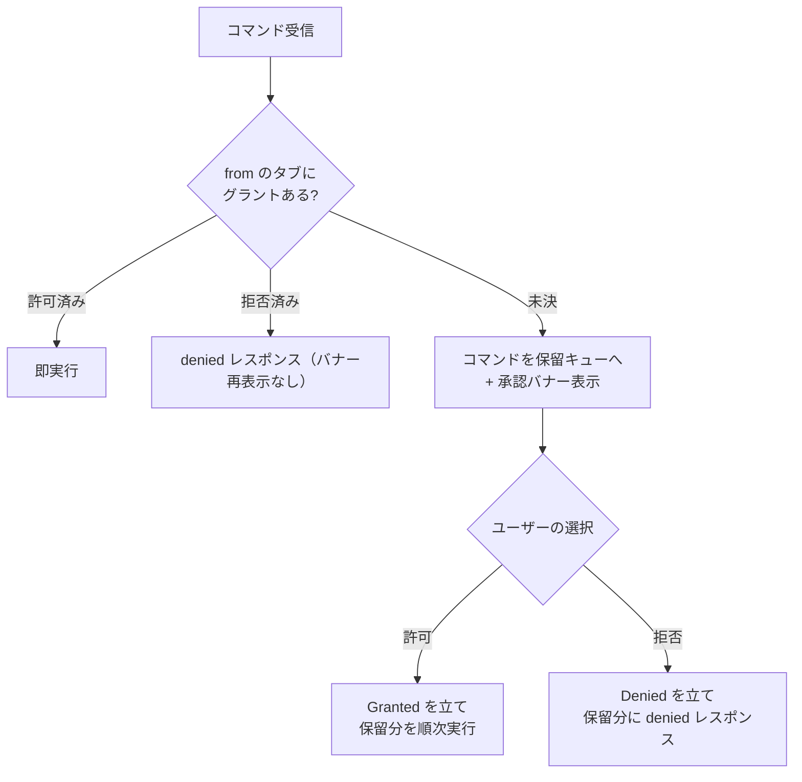

# エージェントオーケストレーション 設計書

| 項目 | 内容 |
|------|------|
| 機能 | エージェント自身によるタブ作成・指示・回収（コマンドファイル・プロトコル + 同梱スキル） |
| 作成日 | 2026-07-09 |
| ステータス | Draft |
| 関連 | design-history D20（ステータスフック）/ D11（共有ワークスペース）/ D8（cc-plugin 例外）/ D2（設計境界） |

---

## 1. 概要

### 1.1 目的

タブ内のエージェント（オーケストレータ）が、**人手を介さず**別のエージェントのタブを作成し、
プロンプトを送り、完了を検知して成果を回収できるようにする。

リフレクション実証（2026-07-09）で「観測系（status ファイル・transcript・レイヤ分離）は既存機構で
完備、欠けているのは spawn/指示の**公式な入口**と **TUI ready 前の入力ロス対策**だけ」と確認済み。
本設計はその入口を、MCP サーバーを新設せずに掘る。

### 1.2 なぜコマンドファイル方式か（選択理由）

| 候補 | 判定 | 理由 |
|------|------|------|
| CoRhino 自前 MCP サーバー | ✗ | HTTP サーバーのライフサイクル・MCP プロトコル実装（SDK 依存 or JSON-RPC 手書き）を抱え込む。D2「CoRhino にツールを実装しない」との緊張も生む |
| Platform ホストへのツール登録 | ✗ | タブはパネルの概念。Platform にパネル知識を漏らすのは責務の逆流 |
| Rhino コマンド + run_command | ✗ | Rhino コマンドラインでのプロンプト文字列受け渡し（引用符・改行）が破綻しやすい |
| **コマンドファイル + watcher** | ✓ | D20（フック → ファイル → watcher）の**逆方向ミラー**。既存の設計言語・実装パターン（FileSystemWatcher、ポート接頭辞フィルタ、temp+move）をそのまま流用できる。req/res もレスポンスファイルで成立する |

知識側（プロトコルの使い方）は cc-plugin 同梱スキル `orchestrate-agents` が運ぶ。これは
D8 の例外（CoRhino 自身の規約を教えるオンボーディングスキル）に収まり、`save-rhino-skill` と同じ棚。

### 1.3 確定済みの要件（インタビュー結果）

- **承認**: タブ単位で一度だけ。初回コマンド時にパネルへバナーを出し、許可後はそのタブからの
  コマンドは自動通過
- **スコープ**: sendPrompt / closeTab は**自分が spawn した子タブのみ**。ユーザーが開いたタブには触れない
- **V1 アクション**: spawnTab / sendPrompt / closeTab の3つ。codex spawn・dumpScreen は V2 送り
- **子のパーミッションモード**: spawn コマンドで指定可能、省略時は通常モード。緩和モード指定時は
  承認バナーにその旨を表示する

---

## 2. 全体像

登場するファイルはすべて `~/.corhino/runtime/` 配下。**C# は watcher と配送だけを持ち、
知識はスキルが持つ**。太字が本設計の新規要素。



噛み砕くと:

1. オーケストレータは **JSON ファイルを1個書くだけ**（Bash の `echo` で足りる）
2. パネルがそれを拾ってタブを作り、**結果をレスポンスファイルで返す**（agentId・status ファイルの
   パス・transcript のパスまで全部入り。オーケストレータは以後このパスを読むだけでよい）
3. プロンプトは**パネルが子の TUI ready を待ってから**流す（実証実験最大のハマりどころの恒久対策）
4. 完了検知（status が idle）と成果回収（transcript）は**既存機構をそのまま読む**。新規機構なし

---

## 3. プロトコル仕様

### 3.1 ディレクトリとファイル命名

| パス | 役割 | 書き手 → 読み手 |
|------|------|----------------|
| `~/.corhino/runtime/agent-commands/cmd-<port>-<uuid>.json` | コマンド要求 | エージェント → パネル |
| `~/.corhino/runtime/agent-commands/responses/<uuid>.json` | 実行結果 | パネル → エージェント |
| `~/.corhino/runtime/tabs-<port>.json` | タブマニフェスト（常時最新） | パネル → エージェント |

- ファイル名の `<port>` で**どのパネル宛か**を表す（status ファイルの `<port>-` 接頭辞フィルタと同型）。
  エージェントは自分のポートをシステムプロンプト注入で知る（→ 3.5）
- 書き込みは両方向とも **temp+move**（`SessionLayers` と同じ規律）。watcher が書きかけを読まないための契約
- 要求ファイルは**パネルが処理後に削除**。レスポンスは**エージェントが読了後に削除**（スキルが指示）。
  取り漏れはパネル構築時のスイープで掃除（自ポートの stale cmd 削除・responses/ の 1 時間超過分削除）

### 3.2 コマンドスキーマ

共通フィールド: `id`（uuid、レスポンスファイル名になる）/ `from`（送り手の agentId）/ `action`。

```json
// タブを作って初期プロンプトを送る
{ "id": "5f3a…", "from": "agent-3", "action": "spawnTab",
  "prompt": "担当レイヤに半径5の球を作って…", 
  "permissionMode": "acceptEdits",   // 省略可。省略時は通常モード
  "name": "builder-1" }              // 省略可。タブの表示名

// 稼働中の子に追加指示
{ "id": "…", "from": "agent-3", "action": "sendPrompt",
  "target": "agent-4", "text": "球を(10,0,0)に移動して" }

// 子を閉じる
{ "id": "…", "from": "agent-3", "action": "closeTab", "target": "agent-4" }
```

### 3.3 レスポンススキーマ

```json
// 成功（spawnTab は子の観測に必要なパスを全部返す）
{ "ok": true, "action": "spawnTab",
  "agentId": "agent-4", "sessionId": "c247bf6e-…", "layer": "s-c247bf6e",
  "statusFile": "/Users/…/.corhino/runtime/status/10500-agent-4",
  "transcript": "/Users/…/.claude/projects/-Users-…--corhino-workspace/c247bf6e-….jsonl" }

// 失敗
{ "ok": false, "action": "sendPrompt", "error": "target agent-9 is not your child" }
```

エラー語彙（V1）: `denied`（承認拒否）/ `not-your-child` / `target-not-running` /
`tab-limit-reached` / `invalid-request`（パース・必須欠落）/ `unsupported-cli`（codex 指定）。

### 3.4 検証ルール（パネル側 dispatcher）

1. `from` が自パネルの live なタブであること（マニフェスト外の詐称 ID は `invalid-request`）
2. `from` のタブに承認グラントがあること（なければ承認フローへ → 6章）
3. `sendPrompt` / `closeTab` の `target` は **`from` の子であること**（`AgentTab.ParentAgentId` で判定）
4. `spawnTab` はタブ総数 **8 個**（`MaxTabs` 定数）未満であること
5. V1 は claude のみ（`cli` フィールドは受けず、常に claude で spawn）

`from` の真正性はローカル信頼（status ファイルと同レベル）。実質的な統制は承認グラント（6章）が担う。

### 3.5 エージェントの自己同定

現状エージェントに注入されるのはレイヤトークンだけで、自分の agentId・ポートを知らない
（実証実験ではリフレクションで逆算していた）。`ClaudeCli.BuildArgs` の `--append-system-prompt` を
拡張し、以下を追加注入する:

> あなたの agentId は `agent-3`、パネルポートは `10500` です。エージェントオーケストレーションの
> コマンド置き場は `~/.corhino/runtime/agent-commands/`、タブ一覧は `~/.corhino/runtime/tabs-10500.json`
> です。使い方は orchestrate-agents スキルを参照。

---

## 4. フルサイクル（シーケンス）

実証実験と同じ「spawn → 指示 → 完了検知 → 回収 → 片付け」の流れが、公式経路でどう流れるか。



ポイント:

- **busy→idle は「ターン終了」であって「成功」ではない**（実証フィードバック 3）。成果検証は
  オーケストレータの責務としてスキルに明記する
- レスポンスは「受理/拒否」の即答。作業の完了は status、成果は transcript と役割分担する

---

## 5. TUI ready ゲート

実証実験で最初のプロンプトが無言で飲まれた問題の恒久対策。**「送れるようになってから送る」責務を
C# が持ち、エージェント側は一切気にしなくてよい**ようにする。

### 5.1 ready の検知

`Workspace.EnsureClaudeStatusSettings` のフック定義に **`SessionStart` → `ready`** を1行足す。
既存の status ファイル（D20）に新しい状態語 `ready` が流れてくる形。

- watcher（`ApplyAgentStatus`）は `ready` を特別扱い: `AgentTab.TuiReady = true` を立て、
  **表示上は idle として扱い**（UI のグリフ語彙は増やさない）、プロンプトキューをフラッシュする
- 未知語破棄の既存契約はそのまま（`ready` だけ既知語に昇格）

### 5.2 プロンプト配送のセマンティクス

`SendPromptToTab(tab, text)` を新設し、生の PTY 書き込みを封印する:

1. `TuiReady` が立つまで `AgentTab.PendingPrompts` キューに保持
2. 配送は **bracketed paste**（`ESC[200~ … ESC[201~`）で本文を書き、**約 150ms 置いて `\r`** を送る
   （改行入りプロンプトの誤送信防止と、TUI の paste 処理完了待ち）
3. spawnTab の初期プロンプトも sendPrompt も**同じキュー・同じ配送路**を通る（経路を2本作らない）
4. 子が busy 中の sendPrompt はそのまま配送する（claude TUI は入力をキューイングして次ターンで
   処理する仕様に乗る）

### 5.3 状態遷移



タイムアウトフォールバック（15 秒で ready が来なければ配送してしまう）は、フック不発
（古い claude・settings 破損）でプロンプトが永久に滞留するのを防ぐ安全弁。ロスの可能性より
滞留の確実な失敗を嫌う判断。

---

## 6. 承認モデル（タブ単位グラント）

> **⚠ この章は D22（2026-07-09）で撤回済み。** 実装・レビュー2巡を経た後の再検討で、
> ブロッキング承認は「コマンドファイルを書く Bash に対する親タブ自身の権限ゲート」と
> 二重であり（default モードの親ならユーザーは既に一度承認している）、from 詐称を
> ローカル信頼とした時点で防御価値も無い、と判断してグラント/バナー一式を撤去した。
> 現在は検証（live タブ + 親子スコープ + タブ上限）のみで即実行し、spawn ごとに
> Rhino コマンドラインへ非ブロッキング通知を出す。経緯は design-history D22。
> 以下は撤去前の設計の記録。



- グラントは `AgentTab.Grant`（Granted / Denied / 未決）で保持。**永続しない**
  （タブが消えれば消える。resume しても再承認）
- **昇格は tier 序数**（レビュー反映）: `GrantedTier`（bypassPermissions=2 > acceptEdits=1 >
  default/plan=0）。同意済み tier を超える spawn は承認済みタブでも改めてバナーが出る
  （acceptEdits の同意は bypassPermissions を覆わない）。バナーはキュー内の**最強 tier** を表示し、
  同意はその表示までしか及ばない。決定待ちの間は後続コマンドも park（FIFO 保全）。
  昇格の拒否は基本グラントを壊さない（同意済み tier 以下はそのまま実行される）
- バナーは WebView 内（タブバー直下）に出す非モーダル UI。表示内容:
  **要求元タブのラベル + 要求アクション + permissionMode（緩和指定時は強調）**。
  ネイティブダイアログにしない理由: UI スレッドをブロックせず、オーケストレータの後続コマンドを
  保留キューで受け続けられるようにするため
- プロトコル追加: C# → UI `onOrchestrationRequest({requesterId, label, action, permissionMode})`、
  UI → C# `orchestrationDecision({requesterId, allow})`
- Claude Code 側のツール承認（オーケストレータが Bash でファイルを書く許可）とは独立の層。
  スキル側で「コマンド置き場への書き込みを許可リストに入れる」ことを案内し、二重承認の渋滞を
  パネル側グラントに一本化する

---

## 7. 親子関係とガード

- `AgentTab.ParentAgentId`（null = ユーザーが作ったタブ）。spawnTab 実行時に `from` を記録
- **sendPrompt / closeTab は親→子の方向のみ**。兄弟・親・ユーザータブへは `not-your-child`
- **孤児は放置**: 親タブが先に閉じても子は走り続ける（ユーザーが UI から普通に操作できる）。
  孤児への公式経路の介入手段が消えるだけで、害はない。V1 ではこの単純さを取る
- **孫は可能だが、承認は世代ごと**: 子が自分の子を spawn する場合、その子自身のグラントが必要
  （承認バナーが再びユーザーに出る）。これが再帰暴走の一次ガードで、二次ガードが
  `MaxTabs = 8`（パネル総タブ数。超過は `tab-limit-reached`）
- タブの UI 表示: 子タブは通常タブと同一（バッジ等は付けない）。ラベルは `name` 指定があれば
  それ、なければ既存の自動タイトル規則に乗る

---

## 8. タブマニフェスト（`tabs-<port>.json`）

オーケストレータの「いま誰がいるか」の観測窓。実証実験で session-layers.json と `_tabs` の
リフレクションで逆算していた対応表を公式化するもの。

```json
{ "port": 10500, "updatedAt": "2026-07-09T07:12:00Z",
  "tabs": [
    { "agentId": "agent-1", "cli": "claude", "sessionId": "aaaa…", "layer": "s-aaaa1111",
      "parent": null, "name": null,
      "statusFile": "/…/runtime/status/10500-agent-1",
      "transcript": "/…/.claude/projects/<slug>/aaaa….jsonl" },
    { "agentId": "agent-4", "cli": "claude", "sessionId": "c247…", "layer": "s-c247bf6e",
      "parent": "agent-3", "name": "builder-1", "statusFile": "…", "transcript": "…" }
  ] }
```

- 更新タイミング: `RegisterTab` / `UnregisterTab` / リネーム時（すべて UI スレッド）に temp+move で全量書き直し
- パネル `Dispose` で削除。パネル構築時に自ポートの stale ファイルを掃除
- transcript パスは cwd slug（`SessionsCatalog.ProjectSlug`）+ sessionId から決定的に組める（D10/D11 の資産）

---

## 9. C# コンポーネント設計（変更ファイルと責務）

既存の責務分離（UI 非依存の static カタログ / パネルがオーケストレータ / UI スレッド規律）を踏襲する。

| ファイル | 変更 |
|---|---|
| `src/Panel/Workspace.cs` | `CommandsDir` / `ResponsesDir` / `TabsManifestPath(port)` の追加。`EnsureClaudeStatusSettings` に `SessionStart → ready` フック追加 |
| `src/Panel/AgentCommands.cs`（新規） | UI 非依存の static クラス。コマンド JSON のパース・検証（スキーマ・エラー語彙）、レスポンス書き出し（temp+move）、stale スイープ。**パネル状態には触らない**（SkillsCatalog と同じ規律） |
| `src/Panel/CoRhinoPanel.cs` | ① command watcher（`StartStatusWatcher` と同型: 自ポートフィルタ → AsyncInvoke → dispatch）② dispatcher（検証 → グラント確認 → 実行 → レスポンス）③ `SpawnTab` 拡張（parent / initialPrompt / permissionMode / name）④ `SendPromptToTab` + `PendingPrompts` + ready フラッシュ ⑤ `ApplyAgentStatus` の `ready` 特例 ⑥ マニフェスト書き出しフック ⑦ 承認保留キューと `onOrchestrationRequest` / `orchestrationDecision` |
| `src/Cli/ClaudeCli.cs` | `BuildArgs`: `--permission-mode <mode>`（指定時のみ）、`--append-system-prompt` に自己同定（agentId / port / コマンド置き場 / マニフェストパス）を追記 |
| `src/Cli/IAgentCli.cs` | `SpawnContext` に `PermissionMode` を追加 |
| `ui/src/main.ts` + `i18n.ts` | 承認バナー（タブバー直下、要求元ラベル + アクション + 緩和モード強調、許可/拒否ボタン）。`onOrchestrationRequest` 受信・`orchestrationDecision` 送信。文言は日英 |
| `cc-plugin/skills/orchestrate-agents/SKILL.md`（新規） | → 10章 |

スレッド規律: watcher イベント → `AsyncInvoke` で UI スレッドへ → `_tabs` 変異・spawn・レスポンス
書き出しはすべて UI スレッド。ファイル読みのリトライ（IOException 30ms 1回）は status watcher の
契約を踏襲。

---

## 10. orchestrate-agents スキル（cc-plugin 同梱）

エージェントが読む「プロトコルの取扱説明書」。C# は入口だけ、**手順の知識はすべてここ**。

構成（SKILL.md 単体、`save-rhino-skill` と同じ形）:

1. **自分を知る**: システムプロンプトの agentId / port / パス。マニフェストの読み方
2. **子を作る**: コマンド JSON の書き方（uuid 生成、temp+move で書く、`echo` ワンライナー例）、
   レスポンスのポーリング（30 秒上限）と読了後削除
3. **待つ**: statusFile を数秒間隔でポーリング。**busy を一度見てから idle になったら完了**
   （spawn 直後の初期 idle を完了と誤認しないための規約）
4. **回収する**: transcript jsonl の tail から最終 assistant メッセージを読むレシピ
   （`tail -c 262144 … | jq` 系のワンライナー）
5. **検証する**: idle = ターン終了であって成功ではない。rhino MCP（list_objects / bbox）で
   必ず裏取りしてから次の指示 or closeTab
6. **ルール**: 子以外に触らない・自分の担当レイヤ規約は子にも伝える（プロンプトに担当レイヤ
   指示を含める）・作業が終わった子は closeTab で片付ける・レスポンスファイルは読んだら消す

---

## 11. エッジケース・既知の制約

| ケース | 挙動 |
|---|---|
| ready が来ない（フック不発） | 15s タイムアウトで配送 + ログ（5.3） |
| 承認バナー放置のままオーケストレータがコマンド連投 | 保留キューに積まれ、決定時に一括処理 |
| 拒否後の再要求 | バナーは再表示せず即 `denied`。タブを作り直せば再挑戦可 |
| 親が先に死ぬ | 子は孤児として走り続ける。ユーザーは UI から通常操作可能 |
| spawn した子の CLI が未解決（セットアップビュー） | spawnTab 自体は成功レスポンス。target への sendPrompt は `target-not-running` |
| `from` 詐称 | ローカル信頼（status ファイルと同水準）。検証は live agentId 照合まで。統制は承認グラントが担う |
| パネル閉鎖時の残骸 | マニフェスト削除・自ポート cmd スイープ。responses は次回構築時に時間ベースで掃除 |
| codex | V1 対象外（セッション ID 後発見の複雑さ。`unsupported-cli` を返す）。ready フックも claude の SessionStart 前提 |
| 別件バグ | PTY env allow-list が macOS で機能していない疑い（PYTHONHOME 漏れ）。本機能と独立に検証・修正する（スコープ外） |

## 12. スコープ外（V2 候補）

- codex 子タブ / dumpScreen（PTY リングバッファ）/ クロスパネル操作
- ホスト側リース・ロック（roadmap 既載。`X-CoRhino-Agent` ヘッダの活用）
- グラントの永続化・許可リスト設定
